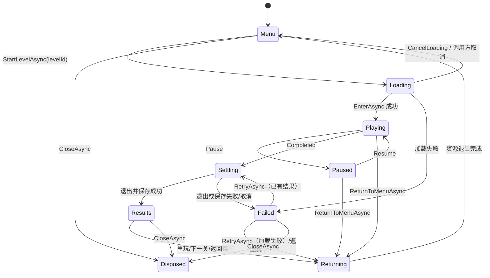

# 关卡与单局流程

`GameRoundFlow` 是通用的单局状态控制器，位于 `DevProject/Assets/Scripts/GameFramework/Runtime/Modules/Gameplay/Flow/GameRoundFlow.cs`。它负责串行加载、暂停、结算、重玩、下一关、返回菜单和关闭；具体关卡、资源、玩法及保存由项目层提供。当前三关收集样例在 `GameLogic/Runtime/Rounds/DemoRound.cs`，窗口在 `GameLogic/Runtime/UI/RoundGameWindow.cs`。



`Loading`、`Settling` 和 `Returning` 是忙碌阶段，同一控制器不会同时启动第二次转场。`CloseAsync()` 也可从其他状态发起：它取消当前操作，等待其结束，再退出会话；退出失败时返回 `false`，调用方可重试。`Dispose()` 是同步兜底，不能代替需要等待异步资源释放的 `CloseAsync()`。

## 接入自己的关卡

实现 `IGameRoundFactory`：`FirstLevelId` 给出首关，`ContainsLevel` 校验关卡，`GetNextLevelId` 返回下一关或 `0`，`Create(levelId, roundId)` 为每局创建新的 `IGameRoundSession`。不要把 `roundId` 当关卡 ID；它用于识别迟到的完成事件和幂等保存。

会话的 `EnterAsync(ct)` 加载本局所需内容；`Completed` 只发布一次 `GameRoundResult(roundId, levelId, won, score, elapsedSeconds)`；`SetPaused(bool)` 暂停本局计时与输入；`ExitAsync(ct)` 停止玩法、注销逻辑场景并等待实例池和资源租约释放；`Dispose()` 提供同步兜底。结果被接受后，Flow 先退出会话，再调用构造函数传入的保存函数，保存成功才进入 `Results`。保存失败会进入 `Failed` 并保留同一个结果，`RetryAsync()` 重试保存；加载失败时 `RetryAsync()` 重新创建一局。结果未保存时 `ReturnToMenuAsync()` 拒绝丢弃结果。

调用侧可按以下顺序组织：

```csharp
var flow = new GameRoundFlow(factory, SaveResultAsync);
await flow.StartLevelAsync(factory.FirstLevelId, ct);
// UI 根据 flow.State 提供 Pause、Resume、RetryAsync、NextLevelAsync 和 ReturnToMenuAsync。
bool closed = await flow.CloseAsync();
```

样例 `DemoRoundSession` 在进入时注册 `DemoRoundScene`，该场景用 `PrefabPool` 加载并生成场地、玩家与收集物，再启动 `DemoRoundGameplay`。场景退出时先停止玩法，随后 `DisposeAsync()` 等待三个实例池归还资源；进入失败和强制退出也有兜底清理。输入上下文与拾取音效绑定本局 `GameplayScope`，摄像机状态由 `SceneScope` 恢复。增加不同玩法时，保持这些所有权和退出顺序。

## 三关样例与启动

`GameMain.StartAsync` 加载 Excel 表和 `GameInputActions`，打开 `PlayerSaveService`，随后创建 `[MiniGameBootstrap]` 并挂载 `RoundGameBootstrap`。入口等待存档激活及 Loading 场景退出，再显示 `UI_RoundGame` 菜单。开始按钮从存档的 `HighestUnlockedLevel` 继续；找不到该关时回到首关。胜利后才可进入下一关，失败或胜利均可重玩。

| 地址或文件 | 用途 |
| --- | --- |
| `GameResources/Rounds/RoundArena.prefab`、`RoundPlayer.prefab`、`RoundPickup.prefab` | 三关共用的场地、角色和收集物 |
| `GameResources/Rounds/Mat_Round*.mat` | 样例材质 |
| `GameResources/UI/UI_RoundGame.prefab` | 菜单、HUD、暂停及结算窗口 |
| `GameResources/Audio/Audio_RoundPickup.wav` | 拾取提示音 |
| `GameResources/Input/GameInputActions.inputactions` | 玩法输入动作 |

这些都是 `GamePackage` 的可热更内容；`RoundDemoAssetsBuilder` 的 Editor 菜单 **Tools → Game Framework → Build Round Demo Assets** 可生成样例 Prefab、材质和音频。更换游戏时应由项目资源替代这些演示资产，保留框架和启动资产的职责边界。

玩家存档定义为 **V2**：保留旧版 `TotalAttacks`，新增 `HighestUnlockedLevel`、`CompletedRounds`、`BestScore`、`LastSettledRoundId`；V1 记录迁移时保留攻击次数并初始化新进度。`PlayerSaveService.SaveRoundAsync` 按 `LastSettledRoundId` 对同一局结果做幂等处理，更新完成局数、最高分及胜利后的解锁关卡，等待写入结果后才让 Flow 显示结算成功。启动时仍需等待存档恢复确认与激活。

## 窗口和场景寿命

`RoundGameBootstrap.ShowWindowAsync(ct)` 可显示或重新打开常驻窗口；外部关闭窗口时，`RoundGameWindow.Close` 会暂停正在玩的关卡或取消加载。窗口关闭后要继续游戏，可再次调用 `ShowWindowAsync()`。业务主动退出或卸载场景前，应先等待 `RoundGameBootstrap.CloseAsync()` 返回 `true`：它等待 Flow 退出会话，然后关闭窗口。Unity `OnDestroy` 仅做同步兜底，不能证明异步资源已归还。

替换项目玩法时，主要修改 `GameLogic/Runtime/Rounds` 的工厂、会话、逻辑场景和玩法，`GameLogic/Runtime/UI` 的菜单与 HUD，以及 `GameLogic/Runtime/Save` 的项目进度。`GameRoundFlow` 只承载通用单局状态，不引入游戏资源地址或特定计分规则。内容变化后按[AI 开发入口](AI开发入口.md)重新准备并构建 `GamePackage`。

系统返回键在局内暂停/恢复，在加载中取消，在结算后返回菜单；模态反馈优先交给 UI 模块。外部关闭游戏窗口会暂停本局，可调用 `RoundGameBootstrap.ShowWindowAsync()` 重新显示。
