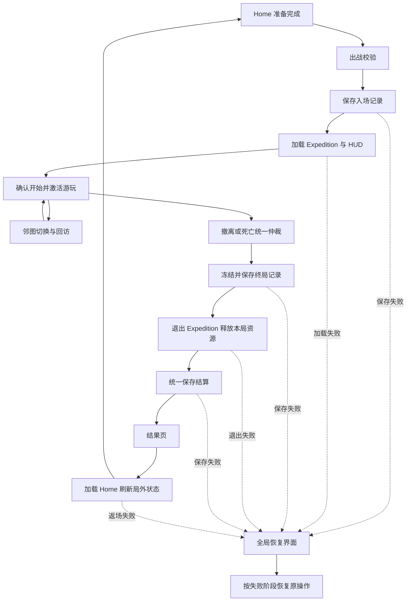

# 主界面与关卡场景流程设计

> **v1 历史归档**：正文中的“当前”“已确认”和验收结果均指 v1 时期。当前设计采用 [V3](../v3/README.md)；本页不要求保留或恢复 V1 运行代码。

更新日期：2026-10-01。状态：场景流程首版代码已接入；本页同时保留完整目标、后续验收条件与尚待确认的玩法策略。实际实现位置和验证状态见[场景流程首版实现与验证](场景流程首版实现与验证.md)，不能把设计表格全部视为已验收行为。

目标是形成可连续游玩的闭环：**主界面准备 → 入场保存 → 加载关卡 → 开始游玩 → 撤离或死亡 → 保存结算 → 查看结果 → 返回主界面**。任何保存或场景失败都留有可操作的恢复入口；同一局不会因为重试重复扣体力、发物品或经验。

玩法依据：[核心玩法设计](核心玩法设计.md)、[M01 单局流程与结算](模块设计/M01-单局流程与结算.md)。2026-09-30 历史代码和验证范围见[首版代码实现与验证](首版代码实现与验证.md)；本轮状态见[场景流程首版实现与验证](场景流程首版实现与验证.md)。本文将技术接入方案与尚待确认的玩法策略分别标明。

## 1. 现状与本次补齐范围

| 环节 | `eb37bc4` 历史实现 | 本轮首版补齐目标 |
| --- | --- | --- |
| 主界面出战 | 等级/体力校验、携装转移、入场保存成功后切 Expedition | 统一流程入口、明确阶段、重复操作拦截、加载界面 |
| 关卡运行 | 地图、ECS、角色输入和 HUD；邻图往返 | 所有内容就绪后统一激活；业务结束与场景销毁分离 |
| 终局 | `FinishRunAsync(bool)` 合并物品、经验、金币并保存 | 按模拟 tick 仲裁、不可变结果、终局持久记录和独立结果页 |
| 返场 | 保存成功后切 Home；内存标记允许重试 | 场景外持续可达的失败界面、Home 就绪确认和结果查阅状态 |
| 重启恢复 | 有 ActiveRunId 时按原型策略退原装备/体力 | 区分未入场、游玩中断、已冻结终局、已结算；避免已确认终局被退款替代 |

上述表格右栏中的 Flow 接入、持久终局与结果、全局恢复窗口和 HUD/Running 就绪后激活已完成首版代码接入。当前实现采用占位内容与开发期恢复策略；定向自动化验证已通过；第 11.2 节完整矩阵及目标设备验收仍待完成。

## 2. 玩家看到的流程

### 2.1 正常出战与返场

1. Home 展示已确认保存的等级、经验、体力、金币、钻石；玩家选择关卡，并在仓库装配、技能界面提升技能。
2. 点击「出战」立即锁定本次请求。校验通过后显示加载界面；不用额外的装备确认弹窗打断流程。
3. 保存体力扣除和携入物品记录，加载关卡、角色、相机、首张地图与 HUD；全部就绪后才接受移动、攻击和交互。
4. 玩家可以不清怪前往相连地图。地图切换属于本局内部操作，不再扣体力、不发撤离奖励、不把战利品放入局外仓库。
5. 有效撤离或死亡后停止游玩，显示「正在结算」；结果保存成功后展示「撤离成功」或「角色死亡」及物品去留、经验和等级变化。
6. 点击「返回主界面」，加载 Home 并刷新最新存档。Home 真正就绪后解除输入阻挡；再次出战创建新 RunId，重新校验资格和体力。

结果页首版只提供「返回主界面」，不提供绕过局外准备的「直接再来一局」。后续若增加快捷再战，也必须经过同一准入和保存入口。

恢复入口按第 9 节的失败阶段路由；结算或返场失败不会重新执行入场扣费。

### 2.2 结果展示

| 内容 | 撤离成功 | 角色死亡 |
| --- | --- | --- |
| 物品 | 当前持有物品全部带回，展示实际实例及随机属性 | 展示安全箱保留物品和箱外丢失物品，包含入场装备 |
| 经验与等级 | 分别展示打怪、撤离经验及升级变化 | 是否保留本局打怪经验由成长策略决定；死亡本身不发奖励 |
| 技能成长 | 展示本次升级新增技能点；已学技能保留 | 已保存技能等级和剩余技能点保留；新点数随实际确认经验计算 |
| 钱包 | 展示本局已确认交易收支 | 按独立钱包/交易策略处理，不套用箱外物品损失规则 |
| 操作 | 保存确认后可返回 Home | 保存确认后可返回 Home |

结果页展示已经到账的结果，按钮含义是返回，不能承担「领取奖励」。不设置成功撤离挑选 X 件、不自动出售战利品，也不因为金币不足转扣钻石。仓库如果后续设置容量，必须先提供完整接收/溢出方案，不能丢弃应带回物品。

## 3. 场景和对象的组织

### 3.1 使用现有场景系统

固定的 `Main.unity`、`Loading.unity` 和 `Framework.prefab` 继续承担宿主启动。每局进出使用 `ISceneModule` 的逻辑场景接口，不重复执行热更启动或重新创建框架。

| 对象 | 生命周期与职责 |
| --- | --- |
| Home 逻辑场景 | 局外内容、主界面、仓库和技能窗口；离开后释放本场景对象 |
| Expedition 逻辑场景 | 本局相机、地图表现、角色表现、Gameplay 和 HUD；整个 Run 内保持同一场景 |
| 单张地图 | Expedition 内的地图节点；换图由地图模块处理，保留本局地图、怪物和奖励状态 |
| 全局流程界面 | 显示加载、结算中、失败重试和结果；Home/Expedition 退出后仍然可见 |
| 项目会话 | 持有存档、流程协调器、冻结结果和当前提交；不归任一 SceneScope |

Home 与 Expedition 使用 Replace，不用 Push/Pop 保留可继续运行的旧 Home。终局时通过现有 `ExitCurrentSceneAsync()` 单独退出 Expedition；允许 `CurrentScene == null`，由全局窗口提供完整背景和操作。无需新增结算逻辑场景或 `.unity` 场景资产。

现有场景模块先退出旧场景，再进入目标；失败会清理目标且可能没有当前场景，**不会自动把原 Home 恢复出来**。因此项目层必须显式恢复 Home，并负责失败入口。

### 3.2 责任划分

下表为项目层职责；其中协调器、会话适配和全局窗口已有首版类型，其他设计名称仍以实际源码为准。不新增第二套通用场景框架。

| 组件 | 职责与现有代码调整 |
| --- | --- |
| `ProjectRunCoordinator`（新增） | M01 的唯一流程入口；协调准入、项目阶段、Flow、场景、恢复和 UI。场景跳转由该协调器编排 |
| `GameRoundFlow`（已有） | 串行管理会话加载、Playing、退出、结算保存、Results；不计算物品奖励、不实际装载 Home |
| `ExpeditionRoundFactory / ExpeditionRoundSession`（新增） | 适配已有 IGameRoundFactory / IGameRoundSession；将 Enter/Exit/Completed 接到项目流程 |
| `ProjectSession`（保留并收敛） | 持有权威局外状态、候选、修订号和统一保存入口；执行入场、终局记录、结算、补偿等事务 |
| `ExpeditionRun`（改造） | 保存本局逻辑状态；按 tick 处理输入和战斗事实，提交终局意图，提供纯数据快照 |
| `HomeScene / ExpeditionScene`（已有） | 只管理所属场景内容和 Ready/退出；不通过 OnExit 猜测本局结局或发奖 |
| `RunTransitionWindow / RunResultWindow`（新增） | 展示阶段和结果、提交重试/返回意图；不直接调用场景模块或修改存档 |

`GameRoundFlow.StartLevelAsync` 已生成 GUID 字符串 RoundId；工厂以它作为项目 RunId，入场提交在会话 `EnterAsync` 内执行，不再额外生成另一个业务局号。关卡 ID、RunId 在 Flow、场景入参、战斗事件和持久记录中一致。另用递增 `OperationId` 区分同局多次加载/返回请求，拒绝迟到回调。

Flow 的工厂 `GetNextLevelId` 在本项目返回 0，不用「胜利下一关」表达等级解锁。所有关卡均从 Home 的已解锁列表选择。

## 4. 项目阶段与框架状态

项目阶段细分 UI 和持久化过程；以 Flow 的实际状态推进，不让两套状态机分别控制单局创建或结算。

| 项目阶段 | 对应 Flow | 输入与完成条件 |
| --- | --- | --- |
| `Restoring` | Menu | 读取档案和处理残留事务；全局恢复界面可用，不能出战 |
| `HomeReady` | Menu | Home、数据和输入就绪；允许局外操作 |
| `AdmissionSaving` | Loading | 锁定出战和局外变更；入场候选确认后继续 |
| `LoadingExpedition` | Loading | 加载角色/地图/HUD；模拟与玩法输入关闭 |
| `Activating` | Playing | StartLevelAsync 已返回成功，保存 Running 标记；确认后激活 |
| `Playing` | Playing | 允许游玩和本局交互 |
| `FreezingOutcome` | Playing，但项目已冻结 | 停止 tick；保存终局记录；成功后才发 Completed |
| `Settling` | Settling | Flow 先退出会话，再调用项目结算保存 |
| `ResultsReady` | 正常结束为 Results；冷启动恢复为 Menu | 保存确认，展示结果；只开放返回 |
| `ReturningHome` | Returning → Menu | Flow 退出完成，再加载 Home、刷新数据和确认结果已查看；期间仍禁止出战 |
| `RecoveryRequired` | 保留失败阶段对应状态 | 只允许当前事务的重试/恢复操作，不能用通用重开掩盖失败 |

允许出战必须同时满足：`HomeReady`、Flow 为 Menu 且空闲、当前 Home 活跃并就绪、没有 ActiveRun 或未决候选、没有待恢复终局、存档可写。单看 Flow Menu 或某个场景名称不足以放行。

Flow 在 `StartLevelAsync` 尚未返回时仍可能 Busy；激活必须在该调用成功返回、`IsBusy == false` 后执行。否则刚加载好就触发 Completed，会被框架的 Busy 保护拒绝。

## 5. 主界面进入关卡

### 5.1 准入与保存

1. 协调器原子锁定出战请求，关闭仓库/技能等 Modal，记录所选 LevelId。若全局过渡窗口无法打开，留在 Home，不开始入场事务。
2. 从最新已确认档案推进体力时间状态，校验关卡配置和等级、体力、携入实例归属、装配等级、技能配置，以及当前是否有其他保存操作。失败返回具体原因并恢复 Home 操作。
3. 调用 Flow.StartLevelAsync。工厂获得 RunId 并创建未激活会话，构建随机种子、连通图、逻辑世界和携入快照；准备失败尚未扣费。
4. 提交入场候选：一次扣除 10 体力、把携入物品从可操作仓库转为 EntryItems 托管、写入 RunId/LevelId/Seed/规则版本及 `Admitted` 阶段。物品实例 ID 和随机属性保持不变。
5. 仅在保存回执覆盖目标修订号后发布入场状态。失败或结果不确定时保留原候选，全局窗口显示重试；不能再次生成 RunId、种子或再扣费。

入场保存属于 `EnterAsync` 的等待条件。可预期的保存失败保持加载待恢复，由协调器重试原保存并解除等待；不是调用 Flow.RetryAsync 新开一局。用户取消只记录取消意图；已经发出的写入必须先判定结果，再按原 RunId 补偿或停止。应用关闭后的恢复见第 9 节。

### 5.2 场景加载与激活

保存后 `ChangeSceneAsync(Expedition, enterData)`；入参只传 RunId、LevelId、OperationId，由项目会话取得对应上下文。场景确认身份和规则版本，建立本局子作用域，按顺序准备：

1. 首张地图和可用出生点；地图状态已绑定同一 Run。
2. 玩家 ECS 实体、初始装备/技能派生属性、敌人和房间内容。
3. 表现映射、相机及地图交互对象。
4. BattleHUD、背包和小地图的初次绑定。
5. Gameplay 与输入上下文已接好，但总开关保持关闭，触屏轴和交互缓存为零。

所有步骤完成才返回 `BattleReady(RunId, OperationId)`，使 `EnterAsync` 完成。协调器等待 Flow.StartLevelAsync 成功返回，再保存 `Running` 阶段；保存确认后关闭过渡遮罩并一次性允许 tick、角色输入和自动攻击。

`Running` 表示持久化的开始授权边界，不声称第一帧一定已经执行。若此标记已保存而进程在第一帧前中断，重启按游玩中断策略处理；不能仅凭画面尚未显示就重复退款。

入场成功必须同时确认同一请求代次、正确场景、有效作用域、Ready 信号和保存回执。任一步失败都不让不可见的角色继续受伤，也不把未完成加载算作死亡。

## 6. 终局仲裁、冻结与保存

### 6.1 唯一终局入口

游戏逻辑提交 `RunEndIntent`（拟议），包含 RunId、Tick、原因、角色与撤离点来源。UI 不再以任意 `bool` 调用终局；死亡来自战斗事实，撤离来自当前地图有效撤离点的触发验证。

建议每个完整模拟 tick 按以下顺序处理：

1. 收束本 tick 已接受的战斗效果、死亡和清图事实；按来源去重记录击杀经验与生成掉落。
2. 校验世界是否有效；若已发生世界故障，进入中断恢复，不能把不完整 tick 强行判为正常结局。
3. 校验玩家死亡；未死亡时才检查当前位置的有效撤离触发。
4. 若有终局，冻结一次；否则继续拾取、交易、安全箱操作和跨图提交。未提交的交互不跨越终局边界。

**建议同一有效 tick 死亡优先于撤离**，仍作为待确认玩法策略。更早 tick 已确认的结局不接受更晚事件覆盖。死亡触发后的清理不能再产生掉落、Buff 到期奖励或交易。

首版代码已改为逐 tick 推进和仲裁，接受终局后停止本渲染帧剩余 tick；同一有效 tick 先检查死亡，再检查撤离。该优先顺序是当前原型策略，正式玩法规则仍待确认。

### 6.2 冻结结果并保存终局记录

接受终局后立即进入 FreezingOutcome：停止模拟与所有变更入口，清零摇杆/按键缓存，拒绝旧请求。冻结 `RunOutcome` 纯数据，内容见第 8 节；它由项目会话持有，不能引用 CombatWorld、GameObject、UI 或可变集合。

先把这份结果写为 `OutcomeRecorded` 终局记录，保留入场托管、尚未应用收益的状态。此时并未入账；保存失败保持本局冻结和全局恢复界面，重试同一份结果，不能退回继续打怪。

终局记录确认后，协调器持有流程独占门禁，核验 Flow 为 Playing、非 Busy、未关闭且 RunId/LevelId 一致，再让会话发布同一结果的 Completed。框架可能静默拒收该事件，因此发布后还要确认 Flow.Result 已保存相同身份，并进入 Settling 或已经推进到 Results/结算 Failed；不能仅以「事件已发送」判定接受。

若未接受，保留已保存的 OutcomeRecorded，在条件恢复后受控重投同一结果，或在流程关闭后走持久终局恢复；不重新冻结、生成奖励或开启新局。一个结果只允许被接受一次，重复通知只是幂等确认。GameRoundResult 的 Won 仅用于通用展示（撤离为 true，死亡为 false），物品、货币和经验不能塞进 Score 或依靠 Won 推断完整规则。

### 6.3 遵循 Flow 的退出再保存顺序

Flow 接受 Completed 后先调用会话 ExitAsync，再执行保存回调：

1. ExitAsync 关闭 HUD、停 Gameplay、断开事件与输入；仅当当前场景确属本会话时调用 `ExitCurrentSceneAsync()`。
2. 释放地图/角色表现、对象池和 ECS 世界，等待异步资源租约退出；冻结结果仍由项目会话持有。
3. 保存回调读取同一 RunId 的终局记录，M06 生成完整物品去留计划，M07 生成尚未提交的成长和交易增量。以最新已确认档案构造结算候选。
4. 将带回物品、箱外损失、经验/等级/技能点、本局交易、入场托管清空、终局标记和结构化结果一次保存。金币与钻石按原交易币种处理；重试不重抽装备属性。
5. 回执确认后才发布局外新状态，Flow 进入 Results，显示结果页。

终局记录和结算候选是两个不同的持久阶段：前者保存「发生了什么」，后者一次应用「本次改变哪些局外数据」。不是把奖励发放两次。检查已结算 RunId/OutcomeId 后，重试只能返回原结果或补写原候选。

Flow 的保存回调类型为 UniTask，正常返回即被当作保存成功。适配层必须等待确认；失败需要按该接口契约进入失败状态，不能记录日志后正常返回。普通项目请求仍优先使用 Try/结果类型，错误通过现有 log 接口记录。

## 7. 结果页返回 Home

1. ResultsReady 时读取已持久化结果展示，保留原选中关卡。结果页关闭、背景点击、系统返回键都不能直接放开游戏输入。
2. 点击「返回主界面」取得独占返回请求，打开全局过渡界面，等待 `Flow.ReturnToMenuAsync()` 完成。正常结束从 Results 返回；冷启动结果页的 Flow 已为 Menu，该调用幂等成功，不把 Results 当作共同前置条件。Flow 只清理单局状态，没有装载 Home。
3. 调用 `ISceneModule.ChangeSceneAsync(Home)`。Home 加载内容、打开 HomeWindow，绑定最新档案并刷新体力时钟、等级解锁、物品和技能点。
4. 原选中关卡仍合法时继续选中；否则选一个已解锁关卡。刚解锁的高等级关卡提示可选，不自动替玩家切换。战利品已在仓库，不自动出售、洗属性或把另一件武器自动穿上。
5. 等待 `HomeReady(OperationId)`；确认无旧 Gameplay、输入上下文或相机残留，再将该结果的查看标记单独保存。
6. 查看标记保存完成后关闭过渡层，恢复局外输入和出战。若保存失败，仍可重试此标记，不能重做结算；重启至多再次展示同一结果。

返回失败时保留已保存的结算和全局界面，按钮改为「重试返回主界面」。无需再次加载 Expedition，也不重新扣费/发奖。Home 已存在但窗口绑定未完成时仍是 ReturningHome，不能抢先开放仓库或技能操作。

全失装备后的可出战条件另按玩法策略处理；界面应准确显示当前装配和缺少条件，不能为了能点出战而暗中恢复已丢失装备。

## 8. 持久数据与资源所有权

### 8.1 建议扩展项目存档

首版沿用同一项目 SaveSession 与快照校验，schema 已升级到 2 并加入 v1 迁移，不增加独立奖励存档。下表为完整目标；当前已落地 Admitted/Running/OutcomeRecorded、终局事实和 LastResult，精确字段以[ProjectRunRecords.cs](../../../DevProject/Assets/Scripts/GameLogic/Runtime/Project/ProjectRunRecords.cs)为准。

| 数据 | 最少字段与用途 |
| --- | --- |
| `ActiveRunRecord` | RunId、LevelId、Seed、配置/策略版本、阶段、入场时间、体力扣费标识和携入实例；区分 Admitted/Running/OutcomeRecorded |
| `RunOutcome` | OutcomeId（与 RunId 一一对应）、结束原因和 tick、有效游玩时长、装备/背包/安全箱快照、击杀来源、未提交经验和交易记录、结束时规则版本 |
| `SettlementReceipt` | RunId/OutcomeId、结算身份、已提交结果和提交标识；重启后也可去重，不只依赖内存 pending |
| `LastRunResult` | 结局、实际带回/丢失物品、经验组成、等级和技能点前后值、交易收支、是否已查看；供场景销毁后展示 |
| `EntryCompensation` | 原入场记录对应的补偿身份及执行状态；补偿写入和清除 ActiveRun 一次提交，防止重试退款 |

提交结算时必须匹配当前 ActiveRun 的 RunId、OutcomeId 和阶段；已提交同一结果则返回原回执，其他旧局请求一律拒绝，不能仅靠「不等于最近一次 RunId」判断为新奖励。只存已经生成的实例数值及纯数据，不存 Unity 对象和回调。物品最终清单以冻结时的位置为准；本局掉在地上而未拾取的物品不算持有物品，不能因成功撤离全部带回。

同一 SaveSession 串行提交，结算锁定期间不接收新的出售、技能升级或补给领取。时间推进由 M09 基于最新档案处理；跨越 5 点重置或补给时间后，返回 Home 必须刷新，不能把入场时整份旧档覆盖回去。已提交的打怪经验/技能点不重复发放，记录策略版本以稳定重试结果。

迁移旧 v1 的 LastSettledRunId 时只承认既有已入账事实，没有明细则展示原摘要，不重新计算奖励。有 ActiveRunId 但没有终局记录的旧档只能走旧版中断策略，无法反推死亡或撤离。

### 8.2 生命周期和清理

| 拥有者 | 拥有内容 | 释放边界 |
| --- | --- | --- |
| `ProjectServices` / 项目会话 | Coordinator、Flow、SaveSession、冻结结果、待提交候选 | 正常关闭先停止新请求并等待流程退出，再释放；强杀依赖已持久阶段恢复 |
| 全局窗口 | 过渡背景、失败/结果 UI、当前打开期间订阅 | 配置使用已有 `GameWindowScope.Global`；随项目会话明确关闭，窗口订阅归 OpenScope |
| 单局会话 | Run 和单局资源登记、输入许可、取消令牌 | 幂等 ExitAsync 等待清理；Dispose 只作同步兜底 |
| 场景/地图作用域 | HUD、表现、Gameplay、输入上下文、资源租约 | 按实际拥有者退出，不重复释放他方持有的数据 |

现有框架有 ApplicationScope 和 SceneScope；项目可从 ApplicationScope 创建玩家会话子作用域，不能假设存在一个现成的 GameEntry.SessionScope。全局窗口不登记到 Home/Expedition 的 SceneScope，且须使用可在没有场景相机时工作的 Canvas 和完整背景。

Run 的 Dispose 统一归单局会话；ExpeditionScene 负责停止和解绑其内容，不同时成为第二个 Run 拥有者。ExitAsync 在加载失败、正常终局和应用关闭都可能调用，应检查所属 RunId/场景身份，分步幂等清理；无本局场景时仍释放已准备的 Run。退出失败后保留尚未释放的租约记录用于重试，不能因为 CurrentScene 已空就假设所有异步资源已释放。

## 9. 失败、取消与重启恢复

### 9.1 运行期间

| 失败位置 | 数据与画面 | 恢复动作 |
| --- | --- | --- |
| 校验/逻辑图准备失败 | 尚无入场提交；保留 Home | 显示具体原因，修正条件后重新出战 |
| 入场保存失败或回执不确定 | 原候选和 RunId 保留；全局 Loading 显示失败 | 重试/确认原修订；不能先退款或再扣费 |
| 入场已保存，Expedition 加载失败 | Run 未获 Running 授权；清理半成品 | 按建议政策将原携入物品与一次扣费补偿写回；保存确认后显式恢复 Home |
| Running 标记保存失败 | 场景已就绪但模拟未激活 | 重试原标记；若请求取消，先确认写入结果，再决定补偿或中断恢复 |
| 终局记录保存失败 | 世界冻结，结果尚未入账 | 重试同一冻结结果；不继续游玩、不创建新局 |
| 会话退出失败 | 终局记录已保存，待完成资源释放 | Flow.RetryAsync 重试未完成退出，成功后继续保存 |
| 最终结算失败 | 场景可能已退出；结果记录和候选保留 | Flow.RetryAsync 重试原候选，不重新加载关卡 |
| 结果页打开失败 | 结算已保存，过渡窗口仍在 | 保留已保存摘要与返回入口，重试展示不重做结算 |
| Home 加载失败 | 结算已保存，结果不变 | 全局界面重试 Home；不调用结算重试或重新出战 |
| 查看标记保存失败 | Home 已就绪但局外门禁未开放 | 只重试查看标记，确认后关闭遮罩 |
| 世界/换图逻辑故障 | 停止本局，记录故障原因 | 进入显式中断策略，不伪造正常撤离或死亡 |

Flow.RetryAsync 在「Failed 且已有 Result」时重试结算；在加载失败或 Results 时可能创建新局。协调器必须按阶段分发按钮，不能所有失败都绑定这个方法。加载失败的补偿完成后先回 Menu/HomeReady，再允许下一次正常出战。

取消在入场提交前可立即清理；提交发出后先收束写入，再恢复已确认的入场记录。首次 Running 授权之后，取消加载不等于免费退局。首版不提供主动放弃按钮，正式放弃规则定义后再接入独立结束原因。

系统返回键由最高层界面处理：Home 弹窗可关闭，游玩时不直接触发场景返回；加载/保存/返场阶段只执行当前阶段允许的操作。切后台建议停止模拟和输入，恢复时不补跑离线战斗 tick；后台时间仍供体力模块结算。平台暂停和强杀政策列入待确认规则。

### 9.2 启动时按持久阶段恢复

读取存档后先进入 Restoring，全局恢复界面可用；残留事务处理完成前不开放 HomeReady。

| 已保存阶段 | 重启动作 |
| --- | --- |
| 无 ActiveRun、无待展示结果 | 加载 Home，完成初始绑定后开放局外操作 |
| Admitted，未获 Running 授权 | 按入场失败政策补偿一次并清除托管；补偿保存失败停留恢复页 |
| Running，没有终局记录 | 无法知道最后一次未保存事件；按明确的游玩中断策略恢复 |
| OutcomeRecorded，尚未结算 | 校验冻结结果并直接重试原结算；不创建 ECS、不退款、不重随机 |
| 已结算、结果未查看 | 不再入账，直接展示保存的结果，随后走返回 Home 流程 |
| 已结算、结果已查看 | 直接进入 Home；旧事件和旧结果不能重新发奖 |

冷启动恢复不伪造 Flow.Completed，也不为恢复旧结果调用 StartLevelAsync。由协调器调用同一个幂等结算事务，确认后展示持久结果；Flow 保持 Menu，返回操作只需完成 Home 就绪和查看确认。

终局记录只有写入确认后才能保证跨重启保留。冻结到写入之间被强杀，存档仍可能是 Running；本方案不会声称能恢复未落盘的事件。当前原型采用「返还原入场装备与体力、舍弃未结算收益和消费」的开发策略，不等于正式强退规则。若正式要求继续半局，还需另行持久化地图、随机状态、角色、敌人、物品、交易、飞弹/Buff 等检查点；本轮不把一个 Seed 当作完整恢复。

## 10. 建议策略与待确认项

本节是为了后续实现可选配置而提出的建议，不覆盖已确认玩法。

| 问题 | 建议方案 | 当前约束 |
| --- | --- | --- |
| 扣体力时点 | 入场记录和携入转移一起保存，确认后加载 | 已确认每局 10；正式扣费时点仍待确认 |
| 加载失败返还 | 未获 Running 授权时原物品和实际入场扣费各补偿一次 | 跨重置、溢出时由 M09 明确补偿口径，不能直接恢复旧体力快照 |
| 同 tick 死亡/撤离 | 有效 tick 内死亡优先；更早终局锁定 | 需要明确为正式规则 |
| 撤离交互 | 进入有效范围后暂停并提示确认；确认后复核状态与位置再提交撤离 | 取消可继续探索，停留范围内不重复自动弹窗；可主动交互或离开重进再次确认 |
| 暂停与后台 | 暂停模拟并清输入，不补跑后台战斗 | 移动端/微信宿主事件接入须另验收 |
| 游戏中断 | 开发期沿用原型补偿并明确提示 | 正式采用检查点继续、死亡或其他政策尚待决定 |
| 死亡经验/钱包 | 通过独立成长和经济策略生成结果 | 原型保留打怪经验、结算 NPC 支出不等于正式确认 |
| 安全箱/仓库/全失后出战 | 复用 M06/M07 规则与准入结果 | X、容量单位、装备保护限制和重新获得武器方案仍待定 |

## 11. 实施步骤与验收

### 11.1 分步实施

| 步骤 | 可修改范围 | 完成标准 |
| --- | --- | --- |
| F1 数据与事务 | ProjectModels、ProjectSession、迁移和纯逻辑测试 | 阶段、冻结结果、结算/补偿幂等、旧档迁移；重复结果不增加物品/经验/体力 |
| F2 流程接入 | 新增 Coordinator/Factory/Session，调整 ProjectServices | 接入 GameRoundFlow；移除旧的并行场景编排；唯一 RunId 与操作门禁成立 |
| F3 场景与激活 | HomeScene、ExpeditionScene、ExpeditionRun、CombatWorld 推进接口 | Ready 前零 tick；终局逐 tick 仲裁；退出只释放一次；返回 Home 等待绑定 |
| F4 全局界面与恢复 | 新窗口、ProjectContent.Ext 登记、Home/HUD 按钮 | 场景为空时也能看到失败并重试；结果只展示已保存内容；冷启动恢复按阶段执行 |
| F5 定向集成验证 | 项目 EditMode/PlayMode 测试 | 覆盖以下完整时序和失败注入；记录真实通过范围 |

F1～F4 已完成首版代码接入，F5 中的定向自动化验证已通过，完整矩阵仍待验证；最终结果以[本轮实现与验证记录](场景流程首版实现与验证.md)为准。当前实现不标记为完整产品或设备验收通过。

### 11.2 必须覆盖的行为

- **正常闭环：** 实际 Home 出战，进入有效撤离点后确认结束，再返回实际 Home；取消应继续探索。多局后顶栏、仓库、技能点和关卡解锁与读回存档一致。
- **死亡闭环：** 由实际伤害造成死亡，不只直接调用结算函数；箱外入场装备和战利品丢失，箱内保留，已保存技能成长不丢失。
- **激活边界：** 延迟 HUD/资源加载期间无移动、攻击、受伤或拾取；Running 保存未确认时仍为零 tick。
- **重复与时序：** 连续出战点击、重复终局、旧 Run 回调、同 tick 死亡与撤离，以及一次渲染帧推进多个 tick，都只接受一次正确结果。
- **入场恢复：** 准备失败、入场保存失败/不确定、已扣费加载失败、取消和补偿重试，不复制装备、不重复扣费或退款。
- **结算恢复：** 终局记录失败、退出失败、最终保存失败、陈旧回执、返回 Home 失败、查看标记失败，分别重试原阶段；无场景时恢复 UI 仍可操作。
- **重启矩阵：** 在 Admitted、Running、OutcomeRecorded、已结算未查看、已查看阶段重新打开存档，走第 9 节对应路径；不把已记录的死亡改为退款。
- **地图与生命周期：** 未清图往返不结算、不收费；终局后所有地图交互关闭；连续进入/退出后只有当前玩法、相机和输入上下文，事件订阅和租约无残留。
- **时间与迁移：** 跨 5 点重置和补给时段返回，时间推进不回退；旧 v1 摘要不重发收益；配置版本不匹配显示可恢复错误，不按新表重抽旧结果。

本轮定向自动化验证已通过，完整矩阵与设备验收仍待完成。2026-09-30 历史记录中的 24 项 EditMode、2 项 PlayMode 不计为本轮完整流程的验证结果；场景和目标设备仍需独立验收。

## 12. 接入依据

- [GameRoundFlow 源码](../../../DevProject/Assets/Scripts/GameFramework/Runtime/Modules/Gameplay/Flow/GameRoundFlow.cs)：StartLevelAsync、Completed 接受条件、退出后保存、RetryAsync 与 ReturnToMenuAsync。
- [ISceneModule](../../../DevProject/Assets/Scripts/GameFramework/Runtime/Modules/Scene/ISceneModule.cs)与[SceneModule](../../../DevProject/Assets/Scripts/GameFramework/Runtime/Modules/Scene/SceneModule.cs)：逻辑场景替换、独立退出、取消与失败清理。
- [ProjectSession](../../../DevProject/Assets/Scripts/GameLogic/Runtime/Project/ProjectSession.cs)与[ProjectModels](../../../DevProject/Assets/Scripts/GameLogic/Runtime/Project/ProjectModels.cs)：首版入场、结算、回执和开发恢复策略。
- [ExpeditionScene](../../../DevProject/Assets/Scripts/GameLogic/Runtime/Scenes/Expedition/ExpeditionScene.cs)与[ExpeditionRun](../../../DevProject/Assets/Scripts/GameLogic/Runtime/Gameplay/Expedition/ExpeditionRun.cs)：当前加载、推进、终局及释放位置。
- [框架单局流程](../../framework/关卡与单局流程.md)、[正式存档](../../framework/正式存档使用指南.md)、[生命周期作用域](../../framework/生命周期作用域使用指南.md)：复用的框架契约。

返回[项目文档导航](README.md)。
