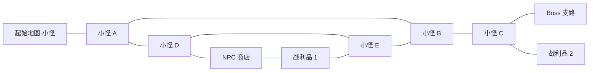

# 关卡与地图设计

> **v1 历史归档**：正文中的“当前”“已确认”和验收结果均指 v1 时期。当前设计采用 [V3](../v3/README.md)；本页不要求保留或恢复 V1 运行代码。

更新日期：2026-10-02。状态：方案与首版实现并存，随机连通图、模板/怪群计划及自由换图已实现，具体范围见[关卡内容首版实现](关卡内容首版实现.md)。用户已确认本轮的地图连通与自由换图方向；本文其余标为“建议”的机制和数值用于原型评估，尚非最终配置。

关联：[核心玩法设计](核心玩法设计.md) · [M04 程序化关卡与房间探索](模块设计/M04-程序化关卡与房间探索.md) · [M03 敌人与房间战斗](模块设计/M03-敌人与房间战斗.md) · [玩法模块与迭代计划](玩法模块与迭代计划.md)

## 1. 方案结论与边界

建议采用**多个地图节点组成一局、地图内自由移动、地图之间通过出口切换**的结构。随机性分为地图连接、地图类型、内部布局与内容三层；玩家选择路线、战斗与搜刮的投入，并决定何时撤离。

| 状态 | 规则 |
| --- | --- |
| 本轮确认 | 一个关卡由随机生成的若干地图组成，地图之间连通 |
| 本轮暂定 | 不必完成当前地图即可前往相连地图；未清怪、未击败 Boss、未拿完奖励都不阻止换图 |
| 延续确认 | 保留小怪、Boss、NPC 商店、战利品四类内容；小地图不标注撤离点 |
| 已确认 | 进入有效撤离点后须确认撤离才结束当局，取消可继续探索；死亡沿用死亡结算。正常撤离全部携出、死亡安全箱外物品全失；已保存技能成长保留 |
| 延续确认 | 角色技能通过升级获点后在局外提升，不生成技能战利品 |
| 本文建议 | 四向双向连接、主路加支路和环路、模板组合、回访状态、撤离保底及探索揭示方式 |

**地图通行和撤离资格分别判断。** 一张地图尚未清理，出口仍可通行，但其中配置为清怪后出现的撤离点尚不可用。切图不是完成关卡，也不会追加一次入场体力消耗、撤离经验或物品携出。

## 2. 层级与用词

| 概念 | 含义与建议建模 |
| --- | --- |
| 关卡配置 | 玩家在局外选择的主题与难度，包含等级要求、地图生成范围、敌人和奖励池 |
| 单局 | 按关卡配置创建的一次冒险，使用一个 `RunId`，持续到撤离或死亡 |
| 地图 | 一块可独立加载和回访的战斗/探索区域，是连接图的一个节点 |
| 地图模板 | 地形、通道、障碍、出生区域和内容插槽的布局资源 |
| 出口 | 同一单局内连接两张地图的通道，两端各有明确的入口锚点 |
| 撤离点 | 结束本局并触发结算的独立世界交互，不与地图出口共用标识或表现 |

首版建议把这里的“地图”对应到旧方案的一个“房间节点”，不额外引入“地图下面再套一张房间图”。地图内部可以容纳多个怪群和搜刮区域。内部拟议契约继续沿用 `RoomId`、`RoomGraph`，`RoomId` 在本方案中标识地图节点；不要同时维护另一套可独立变化的 `MapId`。本轮不重命名已有模块文件。

## 3. 每局规模与连接结构

以下为**原型建议值**，可在试玩后调整：

| 参数 | 建议起点 | 意图 |
| --- | --- | --- |
| 地图数量 | 首个完整原型固定 10 张，随后配置为每局 8～12 张 | 先验证路线选择，再验证规模随机 |
| 小怪地图 | 总数减 4，包含起始地图；10 张时为 6 张 | 承担经验、装备和战斗节奏 |
| Boss / NPC / 战利品地图 | 1 / 1 / 2 张 | 为玩家提供可选择的目的地；这些保底数量仍是建议 |
| 连接形式 | 四向网格相邻、双向通行；大多数节点 1～3 个出口，上限 4 | 连接方向与地图内出口容易对应 |
| 环路 | 连通树上再补 1～2 条边 | 支持绕路、回访和替代路线 |
| 起始地图 | 路线起点角色，首版放在低威胁小怪地图；1～2 个出口 | 不新增第五种内容类型 |
| Boss 位置 | 起点最短路距离至少 3 条边的可选支路 | 不成为其他地图的唯一必经节点 |
| 路线节奏 | 尝试 6～10 分钟的一局；不要求逛完或清完所有地图 | 以真实游玩时间调整规模和收益 |

所有距离都在**补完环路后的最终图**上计算。相邻网格位置不自动意味着相连，只有生成了成对出口的边才可通行。不采用没有落地通道的“视觉上连着”。

### 10 张地图示例

这是开发者查看的完整结构示例，不代表玩家开局能看到全部信息，也不绘制撤离点。

此图有 10 个节点、11 条双向边和 2 个独立环路。可嵌入四向网格：起始/A/B/C/Boss 位于 `(0,0)` 至 `(4,0)`；D/E/战利品 2 位于 `(1,1)`、`(2,1)`、`(3,1)`；NPC/战利品 1 位于 `(1,2)`、`(2,2)`。图中的线条才是实际连接。

玩家可以从 A 绕到 D、NPC、战利品 1，再由 E 回到 B；也可以直接穿过 B/C 去挑战 Boss。任何一条路径都不要求先清理前一地图。离开未清区域保留了后续回访风险，也允许玩家暂时绕开不合适的战斗。

## 4. 地图类型与内部布局

| 类型 | 建议布局 | 收益与离开条件 |
| --- | --- | --- |
| 小怪地图 | 多出口模板；中间放 2～3 组威胁区域，配置绕行空间与少量掩体 | 小怪可能掉物品、打怪有经验；随时可到出口离开；清理后可满足本图撤离点显现条件 |
| Boss 地图 | Boss 区位于地图内部，与跨图入口保留接近距离和回撤路线 | 击杀必掉战利品；允许撤退和以后重来，不要求击杀才能离图 |
| NPC 地图 | 交易区与地图出口分开，首版建议无地图内敌人 | 按商店规则购买；换图不刷新报价和库存；不附送未确认的回血服务 |
| 战利品地图 | 直接奖励散布在可达的搜刮位置，避免所有物品贴着入口 | 可拾取装备或其他物品；不要求拿完才能离开；已拿走奖励不重生 |

起始地图只是一个带 `IsStart` 角色的节点。建议出生区没有立即攻击玩家的敌人，向地图内部行进后才接触怪群；起始附近不安排高价值直出奖励或默认可用撤离点，避免进入后立即结算的固定路线。

### 模板约束

- 每个模板声明可用出口方向、入口锚点、玩家可行走区域、怪群插槽、战利品插槽、NPC 插槽和撤离候选插槽。
- 连接图选择出口集合，模板必须覆盖该集合；不用的出口明确表现为墙面，不留下不可用门的误导。
- 同一地图内，所有启用入口、出口和关键交互点必须通过实际可行走空间连通。障碍随机摆放后重新校验，不能只校验地图之间的图关系。
- 首版建议随机选模板、旋转兼容模板、选择内容插槽和组合小型障碍；暂不做任意地形雕刻。镜像只在美术和碰撞均验证后加入。
- 怪物、陷阱和奖励不生成在到达锚点、传送触发区或必要通道正中。敌人移动形成的临时威胁属于战斗，不能被永久地形封死代替。
- 内部尺寸先按玩家移动速度校准：建议无战斗横穿约 8～15 秒，普通地图主动清理约 30～90 秒；均为体验目标，不先锁定世界单位和怪物数量。
- 给大范围武器留发挥空间，也提供可绕行地形；不要把所有地图做成长直走廊，或让玩家总能隔墙自动攻击。

## 5. 程序化生成流程

建议采用“先连接结构、后内容布局”，在入场准备期间生成完整计划。运行中可以按需加载表现，但首次进入地图时不得重新抽取它的类型与内容。

1. 读取关卡配置与版本，创建 `RunId`、本局种子和生成器版本；抽取地图数量。
2. 从起点在四向网格中扩展，先建立恰含指定节点数的连通树，再对相邻且尚无边的节点补 1～2 条边。
3. 在最终图上重新计算距离、节点度数与关节点。选择起始节点、Boss 支路、NPC 和战利品位置，再把其余节点分配为小怪地图。
4. 首版建议 Boss 不是关节点；移除 Boss 节点后，起点仍能到达所有其他地图。NPC 和战利品不要全部相邻起点，允许分布在不同支路。
5. 按类型、出口方向和主题选择兼容模板，落地实际双向门对及两端到达锚点。
6. 使用独立的随机子序列安排模板变化、怪群、奖励来源、商店与撤离计划；掉落实例生成与领取仍由 M05/M06 负责。
7. 校验地图图连通、实际出口配对、地图内行走可达、类型数量、出生安全、撤离计划与触发可满足性。
8. 通过后冻结本局生成计划，再交给入场流程加载起始地图。建议最多尝试 20 次确定性重生成，失败则选已验证的保底布局；保底也不合法时拒绝进入玩法，按 M01/M09 的入场失败契约处理。

相同种子只有在关卡配置、生成器版本及随机算法一致时才要求结果相同。重试使用确定的派生种子，不能每次读取时间重新抽取。存本局生成结果与版本，回访以记录为准；不能因为玩家先开箱或先买东西而改变尚未进入地图的布局。

## 6. 自由换图与回访

### 换图触发

建议玩家靠近出口后使用交互操作切换，NPC、物品和出口分别显示清晰提示。只检查角色存活、当前单局有效、出口连接合法，以及没有其他切图或终局事务进行中；**不检查清怪、Boss 击杀、地图完成百分比或战利品是否拿完**。

首版所有地图出口双向可走，不设置战斗锁门、清怪钥匙、清图解锁通道或 Boss 战封路。地理上仍需要走到出口，不提供在地图任意位置打开小地图后瞬移。

### 回访状态建议

| 对象 | 建议在本局保留什么 | 切图与回访行为 |
| --- | --- | --- |
| 普通敌人和 Boss | 稳定 ActorId、生命、位置、战斗阶段、剩余冷却和状态效果 | 已死不复活；残血不回满；离图冻结本图敌人模拟，返回按原状态恢复 |
| 玩家 | 生命、装备、背包、安全箱、Buff 及剩余冷却 | 到另一图继续本局状态；不回血、不补充物品、不重置技能冷却 |
| 玩家未完成 Cast/战斗位移 | 切图准备阶段保留原游标；成功提交时以 MapTransfer 取消 | 仅执行取消清理，不带着旧攻击进入新图、不退资源；失败恢复原状态 |
| 源图敌人施法、Buff、所有已发射飞弹 | 时间轴游标、剩余寿命/周期、命中历史和归因，含玩家发射的飞弹 | 随 RoomTick 冻结并留在原图；回访不重放出生/添加/已执行节点 |
| 地面物品与箱子 | 来源身份、生成实例、地面位置、开启/领取状态 | 未拿的仍在，已拿的不重生，不重抽属性 |
| NPC 商店 | 本局商店身份、报价版本、库存与已完成交易 | 不因重进补货或变价；后续独立刷新规则另定 |
| 撤离点 | 本局抽定的候选、条件、显现和有效状态 | 条件未达成仍不可用，已显现的不因离图重新抽签 |
| 探索信息 | 已发现/访问地图、已知连接、战斗清理记录 | 不因卸载表现而丢失 |

首版建议敌人不跨图追击，世界内攻击也不穿过地图边界。加载阶段统一暂停模拟时间，玩家和敌人都不能利用加载推进伤害或恢复；切换成功后，玩家状态计时继续，非当前地图的敌人保持冻结。离图前已经成立的伤害、死亡和收益事件必须先收束，不能用卸载取消。

战斗具体冻结/取消合同见[战斗框架设计](战斗框架设计.md)。敌人未完成攻击和地图飞弹、持续区域保留状态，玩家未完成 Cast 与战斗位移在成功转移时取消；玩家 Buff 则随持有者继续。回访不重放 OnApply、OnSpawn 或已执行时间轴节点，不重复伤害。返场预警补偿参数通过 Boss 往返原型决定，不能简单清空敌人攻击过程。

### 一次切图的流程建议

1. M04 校验出口并锁存 `TransitionId`，短时间重复触发只能对应同一转移。
2. M01 确认当前允许继续本局。按战斗总纲第 5 阶段先收束已成立伤害、死亡及显式死亡清理效果，再接纳切图；已经死亡的角色不能用切图恢复存活。死亡与撤离的最终同帧仲裁仍遵循 M01 的后续统一规则。
3. 停止接纳新的战斗/物品操作，收束已接受事件，取得一致的源地图与玩家状态；源地图不在目标准备成功前丢弃。
4. 准备目标地图资源，按已存在状态恢复；首次进入时才初始化该节点已冻结的内容计划。
5. 目标准备成功后，在同一次转移提交中以 MapTransfer 取消玩家旧 Cast/战斗位移（仅清理），更新当前 `RoomId`、转移与探索状态，把玩家放在目标出口内侧，再恢复输入；Buff/CD 保留，已发射飞弹留在源图。
6. 加载失败不提交 Cast/位移取消，恢复源图、原时间轴游标与玩家状态，不退款式复制装备、不结束本局、不重复扣体力；同一请求重试不能再次搬运或发奖。
7. 通过 RunId、RoomId 和转移代次拒绝旧图迟到事件。到达锚点与出口触发区分开，玩家需要离开触发区或重新主动交互，防止落地立刻自动传回。

地图切换缓存首先保证**当前进程内的本局回访**，不等于已经支持强杀后的续局。异常中断和存档恢复仍由 M01 的统一方案决定。

## 7. 撤离点建议

建议每局保证至少一个可以通过正常玩法触发的撤离点，同时保留额外随机撤离机会。否则玩家可能已经积累收益，却只能靠死亡结束本局。

| 项目 | 首版建议 |
| --- | --- |
| 保底点 | 从非起点、非 Boss 的小怪地图中随机选一张，清怪后显现 |
| 保底点距离 | 建议在最终图中距起点 2～4 条边，且去往该图不需要经过 Boss 地图 |
| 额外点 | 建议 0～1 个；NPC/战利品地图可默认显现，小怪/Boss 地图可按清怪条件显现 |
| 随机时点 | 创建本局计划时抽定候选和条件；切图、重进或重复清理事件均不重抽 |
| 小地图 | 不显示点位、是否含点、是否激活、专用颜色或前往撤离点的导航 |
| 世界内表现 | 玩家到达地图后可以看到已显现的撤离点，图内醒目表现与普通换图出口区分 |

以上数量、距离和保底政策均为建议，不覆盖尚未定案的正式概率。若生成结果没有合格保底候选，应重生成或使用验证过的保底配置，而不是把撤离点放在无路可到或条件不可能满足的位置。

**Boss 是可选的高风险收益，不是本局唯一结束方式。** 保底点并不要求先击败 Boss。清图的意义是获得更多经验、掉落和发现条件撤离机会；不能把这里的清图条件重新套到普通出口上。

## 8. 小地图和玩家信息

建议沿用方格节点加连接线的抽象地图，显示结构而非完整地图内部地形：

- 当前地图：明确高亮；已访问地图：显示类型与已知连接；已访问战斗地图可显示未清理/已清理状态。
- 从已访问地图看到其相邻出口，邻接但未访问节点只显示未知轮廓，不提前公布 NPC、战利品或 Boss 身份。
- 尚未与已访问区域相邻的节点不显示。以上是建议的探索揭示范围，并非此前已经批准的战争迷雾规则。
- 已知连线表达可以换图，不表达地图已完成；未清地图仍显示同样的可通行连接。
- 不展示撤离点相关字段、标记或专用路线。清理标记只能来自普通战斗事实，不因撤离点显现而改变颜色或图标。
- UI 提供当前位置、目标出口方向和地图类型的简短提示；小地图点选仅查看已知信息，首版不承诺自动寻路或传送。

已找到的撤离点也只通过世界内表现识别；“小地图不标撤离点”在发现后仍然成立。开发调试视图可以展示完整图和配置，必须与玩家小地图的数据投影分开。

## 9. 自由路线的收益与约束

| 行为 | 设计判断与建议 |
| --- | --- |
| 不清怪直接过图 | 合法路线选择；少拿经验和掉落，承担接近出口时的攻击风险 |
| 快速寻找战利品房 | 合法搜刮路线；通过支路距离、分布和奖励池控制收益，不能改成强制清怪开门 |
| 返回熟悉地图 | 利用探索成果规划撤离；未清地图保留敌人威胁，清图可以换取更安全的回程 |
| 反复跨门磨 Boss | 保留撤退权；Boss 设在地图内部，入口不提供可攻击的无敌区，换图不回血或重置玩家技能；是否过度容易需要实际测试 |
| 反复进图刷怪、箱子、商店 | 同一节点和来源只初始化一次，死亡/领取/交易记录去重，离图不刷新 |
| 到处跑而没有决策 | 调整地图规模、分叉密度、信息揭示和收益差距；先减少无意义路程，不靠额外锁门补救 |

普通战斗提供稳定的经验获取机会与装备掉落，Boss 建议使用更有吸引力的奖励池，直出战利品则提供搜索惊喜。具体概率与价值需用原型比较“战斗、绕行、快速搜刮”三条路线，不能在未测试前声称已有平衡。玩家依然可选择较低收益的快速撤离。

## 10. 数据与模块责任

以下为拟议契约，不是现有 API：

| 数据或能力 | 所有者与用途 |
| --- | --- |
| `LevelDefinition` | 关卡配置：主题、等级要求、生成范围和各内容配置引用 |
| `RunGenerationPlan` | M04：RunId、种子、配置/生成器版本、最终图、模板和内容计划引用 |
| `RoomGraph`、`RoomId`、`EdgeId`、`DoorId` | M04：地图节点、双向连接、成对出口和到达锚点 |
| `RoomExplorationState`、`MinimapProjection` | M04：内部探索真值与过滤后的玩家地图视图，后者无撤离字段 |
| `TransitionId`、转移上下文 | M04 在 M01 单局阶段许可下协调；一次转移只发布一次 RoomEntered |
| 敌人/玩家战斗状态、`RoomCleared` | M03：敌我生命、阶段、冷却与清理事实；M02 消费当前图位置和动作状态 |
| 奖励来源、物品实例、容器和地面状态 | M06 持有，M05 提供物品与属性；切图不能重抽或复制 |
| 商店与经验 | M07 持有报价/交易与成长记录；换图不是新的经验来源 |
| 撤离计划与显现 | M04 根据配置和 M03 条件维护；进入后由 M01 统一裁决终局 |
| 入场、结束与存档边界 | M01 协调；一局体力扣除由 M09 管理，换图不再次入场 |

首版建议只模拟当前地图，预备邻图所需资源并缓存离图状态。加载与卸载使用既有项目资源机制，避免为了房间数量复制常驻战斗对象。实际内存预算、预加载数量及微信设备表现需实现后测量。

## 11. 开发切片与验收

1. **固定三图验证自由换图：** 小怪图 A、带另一入口的小怪图 B、奖励图 C。A 未清即可进入 B 再返回，检查敌人残血、玩家状态、地面物品和入口定位。
2. **随机连接与模板：** 固定测试种子生成 10 图，覆盖环路、支路、出口配对与内部可达；再开放 8～12 图配置和失败回退。
3. **完整探索循环：** 接入四类内容、商店回访、Boss 必掉和保底/额外撤离建议配置；小地图只收到允许信息。
4. **完整单局与设备：** 联调死亡/撤离、加载失败、旧事件过滤、资源释放、竖横屏与目标设备切图开销，再调路线长度和收益。

未来至少验收：

- 未清普通地图、Boss 存活、奖励未取完时均可沿合法出口到相邻地图并返回。
- 每个节点可达，所有启用门对与内部关键点可通行；Boss 不是通往其他地图的唯一关节点。
- 同一版本与种子复现同一生成计划；不同 RunId 状态隔离；开箱先后不改变未访问节点。
- 回访不复活已死怪、不补满残血敌人、不刷新箱子/掉落/商店、不重复发经验；玩家不能靠切图回血或重置技能。
- 切图过程中加载失败、重复交互、旧图迟到事件不会复制物品、误切当前图或重复扣体力；致死伤害先成立时不能借切图逃过死亡。
- 条件撤离点清怪前不可用、清怪后只显现一次；额外默认点和清怪点不因重进重抽；保底候选确实可达且可满足条件。
- 小地图在未发现、已访问、清理前后以及发现撤离点后，均没有撤离专用数据或标记。
- 到达点不被墙体、怪物初始点或危险区域覆盖，不出现自动来回切图；完成或失败的切换都正确释放资源。

这里只完成设计与文档检查，以上 Unity 行为和设备验收尚未执行。

## 12. 下一轮应确定的参数

优先试玩并确定：地图数量与每图尺度、连接/环路密度、Boss 与奖励分布、敌人离图攻击恢复表现、撤离保底及额外点概率、小地图揭示范围。正式开发前把选定值写入关卡配置；保留“可未清图离开”的本轮暂定规则，变更时同步核心与 M03/M04/M08。

返回[项目文档导航](README.md)。
