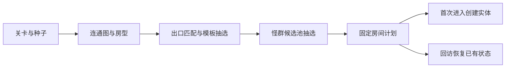

# 关卡内容首版实现

> **v1 历史归档**：正文中的“当前”“已确认”和验收结果均指 v1 时期。当前开发采用 [v2](../v2/README.md)；本页不要求保留 v1 运行代码。

更新日期：2026-10-02。第 3 阶段首版已实现，承接[内容配置化](内容配置化.md)和[关卡与地图设计](关卡与地图设计.md)。

## 交付范围

开局先生成连通房间图，再按出口方向选择布局模板和一组怪群，将选择结果保存在 `LevelRoomState.Plan` 中。进入或回访房间时复用该计划；切换房间仍不要求清怪。

| 内容 | 当前实现 |
| --- | --- |
| 关卡图 | 三个关卡沿用 5×2 网格，每局 10 房；6 小怪房（含起始房）、1 Boss 房、1 NPC 房、2 战利品房 |
| 房间模板 | 7 种布局、按关卡配置的 24 条模板规则；按房型、起始标记、出口掩码和权重选择 |
| 怪群 | 11 组候选遭遇、19 条出生规则；每房只抽一组遭遇，组内可以组合不同敌人 |
| 敌人 | 普通追击、蓄力冲刺、范围重击和一个多技能 Boss |
| 特殊房间 | 专用布局和交互点；商店、宝箱、Boss 各有独立奖励池 |
| 回访 | 敌人生命和死亡、开箱状态、库存、地面奖励和撤离条件保留在本局内 |
| 启动门禁 | 跨表引用、出生安全、出口覆盖、房间内可达性和 Boss 必掉检查 |

玩家仍使用单一近战基础攻击；多技能选择用于敌人。新敌人复用胶囊体 Prefab 与现有动画，通过体型和攻击节奏区分。

## 内容生成与运行

- 生成按稳定 ID 排序后加权抽选。同一套配置与种子产生相同的图、模板、怪群及撤离候选。
- `LevelRoomPlan` 保存 `TemplateID`、`EncounterID`、布局定义、出生组、奖励池、商店价格和库存。开箱和战斗使用各自的运行随机源，不会改变已生成房间的计划。
- `ExpeditionRun` 为每个房间建立独立 ECS 边界和障碍；当前 `Layout` 随房间切换。入口检测使用目标房间的几何及玩家圆形半径。
- 房间表现由已有热更房间、墙体、障碍及交互物 Prefab 组合。离开只释放表现，敌人由 ECS 保留；回访不再次刷怪。
- 撤离点仍采用原规则：至少一个非起始小怪房为清怪后撤离候选，其他非起始房按关卡概率额外生成；NPC/战利品房的候选可直接显示。小地图不暴露撤离信息。
- 生成计划只在当前单局内保留。配置在启动时加载；本轮没有新增半局断点存档。

## 首批房间内容

| 布局 ID | 用途 | 内容 |
| --- | --- | --- |
| 1 | 起始和普通战斗房 | 保留基础障碍，起始房固定两只普通敌人；普通战斗房抽选怪群 |
| 2 | 立柱战斗房 | 立柱间绕行，组合普通敌人、冲刺敌人和重击敌人 |
| 3 | 绕行战斗房 | 通道障碍，模板只允许南北出口；仅在实际出口全部匹配时参与抽选 |
| 4 | Boss 房 | 空旷战斗区域，生成一只 Boss，击杀必掉一件物品 |
| 5 | NPC 房 | 专用商店布局；每件 20 金币、库存 2，奖励来自 `merchant` 池 |
| 6 | 战利品侧厅 | 独立箱子及撤离候选位置，奖励来自 `treasure` 池 |
| 7 | 战利品拱廊 | 另一种障碍与交互点布局，奖励来自 `treasure` 池 |

商店价格、库存及上述数量均为可调首版配置。本阶段提交时 NPC 使用“靠近并交互后购买随机物品”的流程；后续已由[搜打撤交互首版](搜打撤交互首版实现.md)接替为固定商品预览和确认购买。宝箱开启保留一次物品奖励与原有 Roguelike 三选一流程。

## 敌人与 Boss

逻辑帧频为 60 tick/s。攻击预警、动画 Cue、位移及伤害均沿用现有效果系统。

| 敌人 | 技能 | 首版行为 |
| --- | --- | --- |
| 普通敌人 `1` | `2` | 追击后进行扇形近战 |
| 冲刺敌人 `3` | `4` | 0 帧提示，22 帧前冲 2 米（10 帧），34 帧进行近战判定 |
| 重击敌人 `4` | `5` | 0 帧提示，36 帧进行半径 3.2 米的范围重击 |
| Boss `2` | `3 / 6 / 7` | 远程飞弹、近身范围重击、半血后冲刺 |

Boss 的首版选择条件：

- 飞弹 `3`：全生命阶段、0～8 米、优先级 0。
- 范围重击 `6`：全生命阶段、0～3.2 米、优先级 1，38 帧产生伤害。
- 冲刺 `7`：生命不高于 50%、3.2～6 米、优先级 2，20 帧前冲 5 米（12 帧），36 帧进行伤害判定。

`CombatActorSpec.EnemySkills` 只包含纯战斗数据。自动战斗先过滤生命比例、距离、视线和冷却，再在最高可用优先级中按权重选择。每个技能独立计时，角色同一时刻只执行一个技能；生命阶段改变不会强制中断已经发起的技能。没有可释放技能时继续调整距离，目标近于可用技能的最小距离时后撤；离开当前房间后敌人的逻辑钟和冷却冻结。

预警使用已有“下一伤害节点”显示。冲刺伤害预警会随来源位置更新，尚未增加完整冲刺路径展示或技能专用动画。

## 配置入口

所有正式内容的唯一编辑源仍是 `config/excel`。本轮修改 9 张旧表，新增 3 张表；完整项目现在为 25 张表、221 条数据。

| 表 | 作用 |
| --- | --- |
| [CfgRoomTemplates](../../../config/excel/CfgRoomTemplates.xlsx) | 关卡、房型、起始标记、布局、权重、允许出口、怪群池、奖励池与商店参数 |
| [CfgEncounters](../../../config/excel/CfgEncounters.xlsx) | 怪群池、布局、适用关卡 ID 区间和抽取权重 |
| [CfgSpawns](../../../config/excel/CfgSpawns.xlsx) | `EncounterID` 下的敌人类型、数量与出生位置规则 |
| [CfgRoomLayouts](../../../config/excel/CfgRoomLayouts.xlsx) / [CfgObstacles](../../../config/excel/CfgObstacles.xlsx) | 房间边界、出入口、交互点和障碍 |
| [CfgEnemies](../../../config/excel/CfgEnemies.xlsx) / [CfgEnemySkills](../../../config/excel/CfgEnemySkills.xlsx) | 敌人属性、模型、经验、掉落，以及技能选择条件 |
| [CfgCombatSkills](../../../config/excel/CfgCombatSkills.xlsx) / [CfgCombatTimelineNodes](../../../config/excel/CfgCombatTimelineNodes.xlsx) | 技能时长、冷却、施法距离与效果时间轴 |
| [CfgCombatEffects](../../../config/excel/CfgCombatEffects.xlsx) / [CfgCombatAnimationCues](../../../config/excel/CfgCombatAnimationCues.xlsx) | 组合效果与动画映射 |
| [CfgLootPool](../../../config/excel/CfgLootPool.xlsx) | `default`、`treasure`、`merchant`、`boss` 的物品与权重 |

`AllowedExits` 使用位掩码：北 1、东 2、南 4、西 8，15 表示四向都支持。实际出口必须是允许出口的子集；每种必需房型必须拥有覆盖全部可能出口组合的模板。战斗房必须指定怪群池，非战斗房不指定怪群池；NPC 和战利品房必须指定有效的物品池。

原 `CfgSpawns.LayoutID/RoomType/IsStart` 已迁移到模板和遭遇层。`CfgLevels.LayoutID` 仍供默认布局兼容入口使用，实际每房布局来自计划。`CfgProfile.NpcItemPrice` 保留旧配置兼容，当前房间商店只读取模板的 `NpcPrice`。

添加内容后运行导表 `export`、`verify`，等待 Unity 编译，再 Prepare GamePackage。字段结构变化要求代码与表一起更新。

## 校验与验证

启动前检查：

- 布局、怪群、敌人、技能和物品池引用有效；生命阶段覆盖完整，距离条件不超过技能起手范围。
- 单房怪群总数不超过 999；敌人不与边界、障碍、其他出生角色或有效入口重叠；起始房另检查玩家出生。
- 按玩家半径检查所有有效入口、出口及房型交互点，所有房型的撤离候选点也参与检查。
- 采用 0.2 米网格，并对相邻网格之间和目标点接入段检查扩半径后的障碍交叉，防止薄障碍被采样跳过。为限制启动校验开销，布局半边长上限为 32 米；极窄通道可能被保守拒绝。
- Boss 模板的每组可选怪群至少包含一只掉落概率为 1 的敌人，确保必掉奖励。

2026-10-02 实际执行：

- `export` / `verify`：25 张表通过；导表工具测试 **8/8**。
- Unity Editor：**94/94**，包括配置门禁、封路、生成确定性、技能独立冷却、阶段选择、范围选择和旧流程回归。
- Unity PlayMode：**21/21**，包括真实主界面出战/撤离/死亡/返场、Rogue 暂停、配置接入，以及本轮全图往返、NPC 售罄、Boss 非基础技能与必掉奖励回访。
- 25 张源表的 221 条数据与生成 JSON 逐字段一致，本轮 12 张变更表的 157 条数据与内容计划一致。
- 已执行 Prepare GamePackage 并构建本地 Windows 远端内容包 **GamePackage 1.0.9**；25 个配置地址、74 个资源地址及 51 个 Bundle 的文件、大小、哈希和依赖编号核对通过。未发布到 CDN。

验证日志位于本机忽略目录 `verification/stage3-content`。本轮使用代码与自动化验证，人工游玩、平衡调优、移动设备及微信平台验收仍待进行。

## 下一阶段

按既定顺序进入第 4 阶段“搜打撤交互”：局内换装与属性对比、背包/安全箱界面、NPC 商品预览与购买界面。第 5 阶段再扩展随机强化、武器附加效果和高级词条；第 6 阶段补局外商店及成长内容。

第四阶段的后续实现及验证见[搜打撤交互首版实现](搜打撤交互首版实现.md)。
