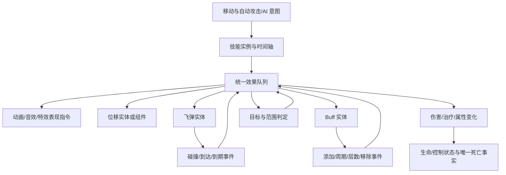

# ECS 战斗框架设计

更新日期：2026-09-30。状态：详细设计草案；已开始首版代码实现，实际范围见[首版代码实现与验证](首版代码实现与验证.md)。ECS、技能时间轴、参数化飞弹、周期 Buff 和效果组合为本轮用户确定的技术方向；本文具体类型、时序、默认策略和示例数值是首版实现建议。

关联：[核心玩法设计](核心玩法设计.md) · [关卡与地图设计](关卡与地图设计.md) · [技能成长设计](技能成长设计.md) · [M02](模块设计/M02-角色移动与自动近战.md) · [M03](模块设计/M03-敌人与房间战斗.md) · [M05](模块设计/M05-物品装备与技能.md)

## 1. 设计结论

采用 **ECS 战斗世界 + 配置化技能/飞弹/Buff + 统一效果执行器**。

- 技能在时间轴节点触发效果；例如第 0 帧播放动画、第 5 帧开始前冲、第 10 帧执行范围判定。
- 飞弹是有独立身份与生命周期的实体；配置运动、目标和碰撞规则，命中后触发效果。
- Buff 是附着于目标的状态实体；添加、周期生效、层数变化和移除等事件可以触发效果，默认按间隔生效、按时长结束。
- 效果是战斗行为的统一入口：动画、音效、位移、飞弹、Buff、伤害等都由效果描述和触发。移动积分、计时、碰撞查询和属性重算由 ECS 系统推进，不把这些内部运算递归包装成无穷个效果。
- ECS 持有战斗真值。GameObject、Animator、特效和 UI 是表现，不独立保存另一份血量或控制技能时间轴。



图中反馈边是受控事件入队，不是 C# 递归调用。每次触发都有身份、稳定顺序和执行预算。

### 分册

| 文档 | 详细内容 |
| --- | --- |
| [技能时间轴与判定](战斗设计/技能时间轴与判定.md) | 施法条件、时间轴、取消与中断、目标选择、范围和多段命中 |
| [飞弹系统](战斗设计/飞弹系统.md) | 直线/抛物线/瞬时、锁定追踪、扫掠碰撞、穿透弹射及终止事件 |
| [Buff 系统](战斗设计/Buff系统.md) | 添加策略、层数、计时、周期效果、属性修改和清理 |

本文件定义跨分册的共同合同。发生冲突时先修订本文件及相关分册，不让不同系统各自选一种时序。

## 2. 与现有玩法和框架的关系

当前玩家仍是**近战自动攻击、所有武器共用一种基础攻击方式**。把普通攻击定义为自动施放的战斗技能，可以复用时间轴与效果；框架支持飞弹不等于重新加入枪械、手动射击按钮或改变武器操作。

必须区分两层“技能”：

| 层级 | 标识与责任 |
| --- | --- |
| 局外成长技能 | 既有 `SkillDefinition` / `SkillId`，M07 保存已学等级与技能点，M05 提供升级及效果配置 |
| 战斗技能定义 | `CombatSkillDefinition` / `CombatSkillId`，定义时间轴、施法条件和效果组合；普通攻击、敌人攻击也属于此层 |
| 一次施法 | `CastId`，记录一次已经接纳的施法状态、目标快照、游标和中断情况 |

成长技能可按等级映射到战斗技能、被动 Buff 或效果参数，但战斗技能不一定对应一个可学习的成长技能。战斗不消费技能点，Buff/飞弹/施法实例都不是背包物品。

本次检查项目源码和依赖：现有 GameFramework 提供玩法更新阶段、资源加载、Prefab 池、生命周期作用域等能力；未发现 ECS 战斗世界，Packages 清单未声明 Unity Entities。**建议先在 GameLogic 项目层设计轻量 C# ECS**；是否选用外部 ECS 库在实现前评估，不把库选型、DOTS、Jobs 或网络锁步当作本轮已批准依赖。

工程接入参考：[玩法更新阶段](../framework/玩法更新阶段.md)、[生命周期作用域](../framework/生命周期作用域使用指南.md)、[Prefab 实例池](../framework/Prefab实例池.md)。框架历史测试结果不代表本战斗方案已通过验收。

## 3. ECS 世界、实体与组件

建议一局一个 `CombatWorld`，由 M03 的项目战斗入口持有；地图使用 `RoomId` 分区。首版在主线程按固定顺序推进，组件使用纯数据，系统执行逻辑；不为每个飞弹或 Buff 建一个独立 MonoBehaviour.Update。

| 实体 | 主要组件建议 |
| --- | --- |
| Actor | 身份/地图、Transform、阵营、基础属性、有效属性、生命、护盾、控制标签、技能可用性、移动意图 |
| SkillCast | CastId、施法者、CombatSkillId/等级参数、目标/位置/朝向快照、时间轴游标、速率、取消策略 |
| Projectile | 实例身份、来源归因、位置/速度/轨迹、目标引用、碰撞规则、寿命、命中历史、终止状态 |
| Buff | BuffInstanceId、持有者、来源、BuffId、层数、属性快照、到期时间、下次周期、TickIndex、Modifier 句柄 |
| Displacement | 持有者、起点/方向/目标、速度曲线或时长、碰撞策略、优先级、开始/结束状态 |
| EffectInvocation | 短命命令记录；一般存队列即可，无需每条都分配长期 ECS 实体 |

实体引用建议为 `EntityRef(WorldEpoch, EntityId, Generation)`；池复用后代次递增，旧引用必须失效。`ActorId` 是稳定业务身份，与易复用的 EntityId 分开。攻击者实体已经死亡或离图时，仍可用记录的 ActorId 正确归因，不能读取复用后的另一实体。

组件存储首版可采用按组件类型组织的稠密数组加索引映射；查询实体集合和空间候选先形成稳定快照，再执行效果。创建/添加组件通过命令缓冲在安全边界提交，不能一边遍历可变集合一边增删。

效果之间允许短提交点：例如第一个 ApplyBuff 注册的新实例，必须能被紧接着的第二个 ApplyBuff 识别并合并。实体销毁先标记为不可参与战斗，实际回收放到 tick 尾部。新实体什么时候运动由明确的 `EligibleTick` 决定，不依赖它恰好在哪个循环里被创建。

## 4. 时间与固定执行顺序

### 时间基准建议

- 首版建议 `CombatTickRate = 60`，默认一设计帧等于一个逻辑 tick。渲染 30/60/120 FPS 不改变技能第 5 帧和第 10 帧的逻辑时刻。
- 秒配置在导入时换算为整数 tick：正持续时间/间隔使用向上取整并至少 1 tick；0 延迟事件和瞬时飞弹另设明确模式，不拿 0 作除数。
- `WorldTick` 作为调度序号；玩家身上的技能冷却和 Buff 采用活跃单局时间，地图内敌人、其施法和地图飞弹采用该地图的 `RoomTick`。离图只冻结地图钟，加载阶段双方都暂停。
- 接入现有玩法更新入口，通过一个 CombatWorld 驱动器独占累计时间和步进。不得把 Unity FixedUpdate 的一次调用直接假定为一个 60Hz 战斗 tick，也不得同时在 Update 与 FixedUpdate 重复推进。
- 一次渲染落后时执行多个完整 tick，不能直接跳过中间时间轴节点或 Buff 周期。追赶预算和持续过载策略需要性能实测；不能为追帧静默丢掉伤害事件。

### 每个 tick 的规范顺序

| 阶段 | 工作与可见结果 |
| --- | --- |
| 1. 边界与到期 | 处理应到期/移除的 Buff、冷却就绪及其效果队列，撤销属性句柄并重算必要属性；到期先于本 tick 的周期生效 |
| 2. 已有运动与碰撞 | 推进已有普通移动、战斗位移和飞弹，获得空间查询结果；排空运动到达/命中效果队列并落地伤害 |
| 3. Buff 周期 | 触发仍有效且本 tick 到时的 Buff 周期，按稳定顺序排空效果队列 |
| 4. 施法与时间轴 | 读取移动/AI/自动施法意图，接纳合法施法并执行第 0 帧；推进已有时间轴到本 tick，排空其效果队列 |
| 5. 死亡收束与事实 | 收束死亡清理及显式死亡效果，再发布唯一死亡、清图和战斗结果；确认换图边界、结构销毁并输出表现与快照 |

阶段 4 接收的普通移动意图从下一 tick 的运动阶段生效。新持续位移和运动飞弹也从创建后的下一 tick 开始积分。瞬时飞弹在创建点通过当次效果队列立即查询命中，不等待运动阶段。

因此，“第 5 帧启动持续 5 tick 的前冲”在第 6～10 帧移动，第 10 帧时间轴的范围判定读取移动后的坐标。第 0 帧在施法接纳的 tick 执行一次。

伤害效果执行时立即修改生命；首次归零立即标记 `DeadPending`，后续队列不能让它继续普通攻击或被普通治疗复活。第 5 阶段才发布一次 DeathId 并回收实体。此顺序意味着同 tick 中已有飞弹、Buff 周期可能先于新施法致死，这是建议的明确裁决规则，不由监听注册顺序决定。

每阶段先收集根触发，按稳定 ActorId/实例 ID/事件序号/配置节点顺序排序。子效果追加到 FIFO 尾部，不递归插队；两个独立根触发之间的顺序也必须固定。某个中断使 Cast 无效后，它尚未执行的时间轴效果再校验时取消；已经独立生成的飞弹/Buff 不因此被追溯撤销。

### 第 5 阶段的死亡效果收束

死亡可以导致 Buff 移除效果再伤害其他目标，必须在清图和换图前收束：

1. 将 DeadPending 角色按稳定 ActorId 放入死亡工作表；保存致死的 Invocation/归因快照并锁存唯一 DeathId，每个角色只进入清理一次。
2. 失活角色的施法与运动，按 TargetDeath 清除其 Buff/属性句柄；显式允许该原因的 OnRemove 效果进入统一 FIFO。效果使用已保存的死亡位置/来源快照，可以查询其他存活目标，不能给已死角色普通治疗或重新施法。
3. 排空这些效果；新产生的 DeadPending 加入工作表，继续至工作表和效果队列均为空。继承致死链的深度与预算，不因新 DeathId 重置同 tick 预算；超限进入 CombatFault。
4. 收束结束后发布各 DeathId 一次，再按最终存活数发布 RoomCleared；此后才接纳合法换图、回收结构及输出表现。监听死亡事实的奖励模块不反向插入未排序的战斗伤害。

来源死亡策略同样在此阶段登记。非当前图中显式 RemoveOnSourceDeath 的 Buff 记为待移除且禁止后续周期；该图恢复时先按 SourceDeath 清理，若配置移除效果则在该图下一次阶段 1 排空，不能在冻结图远程扣血。默认持续 Buff 不受此策略影响。

## 5. 效果定义、上下文与执行器

### 定义

`EffectDefinition` 建议包含 `EffectId`、`EffectType`、版本、目标绑定、条件、类型专用参数以及结果分支引用。采用类型化参数或导入后的类型化记录，避免运行时用任意字符串字典读取伤害字段。

`EffectGroup` 保存有序效果引用；`HitQueryEffect` 对稳定排序的命中目标分别创建子上下文，再触发组。一次效果组不是自动回滚事务：前一个效果已经合法造成伤害，后一个因目标离开而失败时，不回滚之前的伤害。

### 上下文

| 字段 | 语义 |
| --- | --- |
| RunId / RoomId / WorldEpoch | 当前单局、地图边界和世界代次，阻止跨局或跨图误命中 |
| SourceEntity | 直接触发者，例如 SkillCast、Projectile 或 Buff；执行前验证代次 |
| InstigatorActorId | 最初责任角色，用于伤害、击杀、掉落和经验归因；不依赖来源 GameObject 存活 |
| TargetEntity / TargetPoint / Forward | 明确的目标实体、位置和方向；每个定义声明使用快照还是执行时读取 |
| RootExecutionId / TriggerId | 原始战斗行为的因果关联，以及本次时间轴节点、命中或 Buff 周期事件身份 |
| EffectInvocationId / ParentInvocationId | 当前执行及父执行身份；目标和命中序号参与派生，不能只按 EffectId 去重 |
| 参数快照 / 配置版本 / 随机流 | 保存等级、攻击属性采样规则、事件数值和受控随机子流 |
| ChainDepth / 预算域 | 防止效果循环和同帧爆炸；定时事件有新的触发预算，但保留来源因果关联 |

Buff 每个周期、飞弹每次合法新命中都有独立 TriggerId；同一次事件的重复回调复用原身份并返回原结果。时间轴同一个 EffectId 在不同节点或不同合法命中目标上仍应执行，不能被过度去重。

### 执行过程

1. 验证世界、地图、实例代次、来源生命周期策略、配置和目标绑定。
2. 按配置解析目标，并检查存活/阵营/控制/距离等必要条件；不要每个 EffectExecutor 自己发明一套距离单位。
3. 执行器形成具体命令或更新受控数据；跨系统的结构改动在安全提交点生效。
4. 记录类型化结果，如伤害实际扣血、被盾吸收、位移受阻、Buff 合并结果。
5. 按结果条件追加子效果；缺目标、免疫、受阻和取消是正常结果，不为预期失败抛异常。
6. 输出表现事件，表现失败不能重新造成伤害。配置错误和执行预算故障使用项目现有 log 接口定位来源链。

读取“上一次伤害结果”等条件必须指向本目标分支的明确 InvocationId，不能共享一个全局 LastDamage，避免群攻 A 的伤害结果影响 B。

## 6. 首版效果目录

| 效果 | 主要参数与行为 |
| --- | --- |
| PlayAnimation | 目标表现体、动画标识、速度、混合与打断标签；仅输出表现指令 |
| PlayVfx / PlaySfx | 资源键、挂点/世界坐标、跟随方式、时长和作用域；不保存 Unity 对象引用到战斗组件 |
| HitQuery | 形状、中心/朝向绑定、距离/高度、阵营/标签、遮挡、目标数、排序及命中组 |
| DealDamage | 伤害类型、系数/固定值、属性采样、暴击和结果效果；统一走伤害管线 |
| Heal | 数值与目标条件；默认限制在存活目标的生命上限内，复活是未来独立规则 |
| ApplyBuff / RemoveBuff | Buff 定义、来源、层数、添加/移除原因；默认按 Buff 分册的合并规则 |
| SpawnProjectile | 飞弹定义、出生锚点、方向/目标、来源快照和覆盖参数 |
| Displacement | 自身或目标、方向/目的地、速度/持续时间、碰撞与优先级、到达/受阻效果 |
| AddAttributeModifier / RemoveAttributeModifier | 属性、运算与唯一句柄；由 Buff/技能等持有者配对管理，避免永久累加 |
| Conditional / EffectGroup | 有限条件与有序组合，不开放任意脚本递归执行或运行时 eval |

护盾、资源消耗、控制标签等也经类型化效果或它们的受控命令落地。资源消耗只涉及已定义的战斗资源/冷却，不能默认把局外体力、金币、钻石或技能点作为每次攻击消耗。

效果系统可以以后增加召唤、连锁、吸血、反伤、场地和光环等执行器。扩展先定义触发和生命周期合同，再注册新类型；当前不因列出扩展而新增玩法内容或收费规则。

## 7. 目标、判定与伤害

目标系统分三步：**能否开始施法 → 效果触发时寻找候选 → 对每个目标结算实际结果**。施法距离不等于伤害半径，锁定某个敌人不等于一定命中它。

- 近战默认建议在 XZ 平面做距离和扇形/圆/盒/胶囊判定，并独立检查垂直高度。范围来自 M05 汇总的当前武器和技能参数，算法和字段详见技能分册。
- 广相查询只产生候选；精确形状、阵营、死亡状态、遮挡和排除列表过滤后，按距离及稳定 ActorId 排序。一个角色多个碰撞体先按 ActorId 归并。
- 无敌、护盾、格挡和伤害免疫属于伤害结果判断；几何命中不能直接当作成功扣血。附加 Buff 是否需要实际伤害大于零，由结果条件配置，不隐含绑定。
- 连续判定窗口需配置每目标命中次数或间隔，并按 Cast/节点/窗口/目标记录；单次扇形不会每个渲染帧重复伤害。

伤害管线建议依次处理：有效目标与免疫 → 基础数值及来源加成 → 暴击等配置随机 → 防御/减伤 → 护盾吸收 → 实际扣血与归零标记 → DamageResult → 受击、吸血/反伤等结果效果。各阶段保持非负和有效范围，生命不低于零；具体公式、伤害类型和系数待数值设计。

来源属性建议允许 `OnCast`、`OnSpawn`、`OnApply` 快照及显式的执行时采样；定义必须选定采样点。持续飞弹或 Buff 的来源死亡后，默认仍可使用快照归因。目标防御默认在命中时读取；不能默默使用失效源实体当前属性。

只有实际从存活变为死亡才生成一个 DeathId。M06 用它请求物品掉落、M07 按已确认口径处理经验；EffectExecutor 不直接修改仓库、金币或等级。Boss 必掉仍由 Boss 死亡事实与 M06 保证。

## 8. 位移与控制

建议移动分为普通移动意图和战斗位移。普通移动由 M02 的移动系统消费意图；前冲、击退、拉拽由 DisplacementEffect 创建持续状态，统一写入 CombatWorld 的位置，不能让动画根运动和 ECS 同时移动角色。

- 默认建议优先级：不可行动限制 → 强制击退/拉拽 → 技能前冲 → 普通输入；强制位移是否受特定控制标签阻断由配置明确。
- 同一角色首版只允许一个主导战斗位移；更高优先级替换，低优先级拒绝，不把多个速度无界相加。
- 每 tick 沿位移段校验碰撞和合法落点，受阻返回 OnBlocked；默认不穿墙。位移本身不隐式造成伤害，冲撞伤害另配命中效果。
- 技能结束、中断、目标死亡、切图和世界销毁分别有清理原因，位移取消不能残留每帧推力或继续占用行动状态。
- 带持续属性/控制效果的生命周期建议由 Buff 管理，通过引用计数/句柄释放；一个减速移除不能顺带清掉另一个来源的减速。

## 9. Buff 共同默认值

具体合并矩阵见[Buff 系统](战斗设计/Buff系统.md)，这里固定跨系统时间语义：

- T 添加，间隔 I、持续 D，活跃区间为 `[T, T+D)`；默认第一个周期为 `T+I`，仅在 `T+kI < T+D` 时触发。
- 在到期 tick 先移除再处理周期，因此恰好同时到期与周期时不额外跳一次。需要“到期爆炸”就显式配置 OnExpireEffects。
- OnApplyEffects 与周期效果分别配置；默认添加不隐式补一次周期。立即生效只能通过显式选项触发并去重。
- 默认合并键为持有者、BuffId、SourceActorId；叠加、替换、重置时长分别定义，跨来源合并和逐层独立计时作为后续扩展。
- 属性增减使用 Modifier 句柄撤销；反复刷新不累加重复常驻属性。自然到期、替换、驱散、死亡与运行时销毁不能混成一个“消失即爆炸”回调。

示例：T=0、I=60、D=180 时，周期触发在 60、120，180 先到期移除；这是本方案边界选择，不假定所有 Buff 必须持续 3 秒。

## 10. 飞弹共同默认值

具体参数矩阵见[飞弹系统](战斗设计/飞弹系统.md)：

- 轨迹、目标绑定与追踪是分别配置的维度。直线可以固定方向或显式配置追踪转向；抛物线首版锁定目标点快照，不能既要求固定完整抛物线又无限追随移动目标。
- 瞬时飞弹在目标点建立实例身份并立即判定，不用距离除速度模拟到达，不因为显示特效多停几帧而再次命中。
- 高速飞弹检查上一位置到当前位置的扫掠路径；先排序最近合法接触，再决定墙体阻挡、穿透和命中效果。
- 同一次命中只有一个 TriggerId；多个碰撞体和重复物理回调不能重复结算。对同目标再次命中必须有明确次数/间隔规则。
- 自然到期、命中耗尽、到达目标和外部销毁分别记录终止原因；OnHit 与 OnExpire 不能隐式各造成一遍爆炸。

## 11. 换图、冻结与恢复

保持[关卡与地图设计](关卡与地图设计.md)的自由通行：不能因为正在施法或 Boss 未死就锁地图出口。建议只在 tick 安全边界接纳转移，已经成立的伤害和死亡先处理。

| 对象 | 首版建议处理 |
| --- | --- |
| 玩家生命、Buff、冷却、装备和背包 | 随玩家保留；加载不推进时间，成功进入新图后按活跃时间继续 |
| 玩家未完成 Cast 与战斗位移 | 目标准备成功、正式提交换图时以 MapTransfer 取消；只清理，不执行带伤害/奖励的取消回调，不退资源或重置冷却 |
| 源地图敌人 Cast、Buff、飞弹 | 随 RoomTick 冻结，包含玩家已经发射并留在该地图的飞弹；不跨图寻敌或造成伤害 |
| 加载失败 | 不提交玩家 Cast/位移取消，恢复源图一致快照、时间轴游标和状态 |
| 恢复地图 | 读回剩余时间、轨迹阶段、HitHistory、Buff TickIndex 等；不重放 OnApply/OnSpawn/已执行时间轴节点 |

这细化了上一版“玩家状态保留”：保留生命、Buff 和冷却，不把前一地图未执行的第 10 帧伤害带到新地图。需要跨图持续的特殊技能以后单独设计。敌方未命中攻击/持续区域的返场预警可以重新呈现，但不能借表现恢复再发一遍已经成立的伤害。

源飞弹重新激活时，如果锁定玩家已经不在同图，执行配置的目标丢失策略；来源 ActorId 保留用于归因，EntityRef 不得跨代使用。表现对象回收不代表 Buff 到期，地图挂起也不是世界销毁。

这些快照首先满足进程内回访。异常退出恢复策略仍由 M01 决定，本轮不宣称已支持崩溃续局。

## 12. 组合例子

### 统一近战基础攻击

| 设计帧 | 节点 |
| --- | --- |
| 0 | PlayAnimation：普通近战挥击，朝向取施法快照 |
| 5 | Displacement：沿朝向启动 5 tick 前冲；距离用测试参数 |
| 10 | HitQuery：以当前角色位置做扇形/距离/高度过滤 → DealDamage |
| 后续配置帧 | 后摇结束，释放动作占用；冷却与时间轴倍率分别按配置处理 |

这是用户所述时间轴的结构示例；是否给所有普通攻击前冲、具体半径和伤害须通过手感原型确定。不同武器可改变范围、数值与附加效果，但保持当前统一基础操作。

### 命中附带周期伤害

```text
技能节点 → SpawnProjectile
飞弹合法命中 → HitQuery/目标绑定 → DealDamage
伤害结果满足配置条件 → ApplyBuff
Buff 周期 → DealDamage
Buff 到期 → 撤销属性句柄；仅显式 OnExpireEffects 才有额外战斗效果
```

### 瞬时地面范围效果

```text
技能节点 → SpawnProjectile(Instant，目标点快照)
创建点 → 圆形查询 → 对合法目标分别 DealDamage / ApplyBuff
该瞬时实例本次命中完成 → 标记终止并在安全边界回收
表现特效可继续播放，但没有第二份伤害计时器
```

以上配置用来验证框架组合能力，不新增武器、可学习技能或战利品品类。

## 13. 配置、校验与调试

建议通过既有 Excel → JSON 导表链路生成：CombatSkill、TimelineNode、Effect、HitQuery、Projectile、Buff、AttributeModifier 及引用关系。表名为拟议；不在本轮创建空配置表或生成代码。

导入至少校验：ID 唯一与引用存在；时间轴顺序/结束边界；时间和数值范围；目标绑定；飞弹模式参数互斥；Buff 间隔/时长/最大层数；属性句柄释放；效果图的明显零延迟循环。缺少战斗必需配置时拒绝相应定义进入玩法，不以默认 0 伤害掩盖错误。

零延迟效果链不得无限展开。首版可用深度 16、单触发 256 条、单 tick 4096 条作为**待压测的调试预算**；正时间间隔的下次 Buff 周期是新 TriggerId，不能因存活较久累计耗尽一次性预算。预算超限记录完整因果链并进入可诊断的 CombatFault，停止继续推进战斗，交由 M01 的错误边界处理；不静默丢伤害，不擅自算死亡或撤离。

调试记录至少包含：tick/阶段、RunId/RoomId、Cast/飞弹/Buff 实例、TriggerId/EffectInvocationId、目标、结果/跳过原因、随机种子与配置版本。支持逐 tick 查看时间轴、碰撞形状、飞弹扫掠和 Buff 下次触发时间；调试可视化不进入正式玩家小地图。

首版目标是单机可诊断和同构建环境的稳定回放测试。排序与受控随机不能自动保证浮点运算、物理查询跨平台位级一致；网络锁步不是本轮已实现能力。

## 14. 模块归属与落地次序

| 模块 | 新边界 |
| --- | --- |
| M02 | 输入、自动索敌与施法意图、角色移动系统；通过 CombatWorld 读写受控位置，不单独扣血 |
| M03 | CombatWorld、执行调度、技能/飞弹/Buff 运行实例、效果执行器、战斗生命与唯一死亡/清图事实 |
| M05 | 静态定义、装备/技能参数、纯属性和数值计算；不直接写生命、移动实体或执行队列 |
| M04 | 地图生成/通行、挂起与恢复协调；在战斗安全边界换图，不自己重置技能和 Buff |
| M06 / M07 | 通过唯一战斗事实处理物品和成长；M07 继续独占局外技能点与已学等级 |
| M08 / 表现适配器 | 提交意图、读取快照和表现事件；动画回调不作为伤害权威 |

建议代码最终位于 `GameLogic/Runtime/Gameplay/Combat` 下的 World、Components、Systems、Effects、Skills、Projectiles、Buffs、Queries、Presentation；这是未来目录建议，本轮只维护设计文档，不复制框架基础服务。

1. **C0 公共内核：** 实体代次、组件存储、固定 tick、效果队列、目标查询与伤害/死亡，先在无表现环境验证。
2. **C1 近战闭环：** 自动普攻、0/5/10 时间轴、位移和扇形判定；映射原 I1 单图战斗。
3. **C2 飞弹与 Buff：** 三种基础飞弹、目标丢失、周期伤害、叠加/替换/重置、属性撤销和链路去重。
4. **C3 房间与表现：** 跨图冻结/失败回退、动画特效适配、池复用和 Boss 事实；接入原 I2/I3 的结算与探索。
5. **C4 内容扩展与压测：** 按需求接穿透弹射、复杂控制和更多效果，测实体数、查询次数、分配与帧耗时，再决定是否并行化。

## 15. 后续验收重点

- 30/60/120 渲染 FPS 下相同输入的逻辑节点次数一致；长帧不漏第 5/10 帧和 Buff 周期。
- 0/5/10 示例的动画、位移和伤害顺序一致；打断后不执行未到节点，已经生成的飞弹按自身生命周期处理。
- 瞬时飞弹不除零，高速飞弹不越过首个阻挡，单角色多碰撞体不多次受伤；重复回调不会重复 OnHit。
- 三种 Buff 添加策略的层数/到期/下次周期严格符合分册；刷新不重复属性，替换不误触自然到期爆炸。
- 同 tick 的飞弹、Buff、技能效果按固定阶段裁决，生命归零后不再施法；死亡移除效果造成连锁击杀时先收束、再清图，一个角色只发布一次 DeathId。
- 命中、实际伤害、护盾吸收、附加状态条件可分别观察；无目标和失效引用正确返回结果。
- 世界或池对象复用后旧异步表现回调和 EntityRef 无效；地图恢复不重放伤害、Buff 添加或飞弹出生效果。
- 未完成技能可正常换图，成功切图取消局部 Cast 但保留玩家 Buff/CD，加载失败恢复原状态；敌人和源图飞弹不跨图伤人。
- 效果循环和错误参数在导入/运行边界被识别，诊断包含因果链；不让静默跳过改变奖励或结算。

设计提交的验收只覆盖文档一致性与链接。后续代码与测试结果见[首版代码实现与验证](首版代码实现与验证.md)；设备性能另行验收。

返回[项目文档导航](README.md)。
