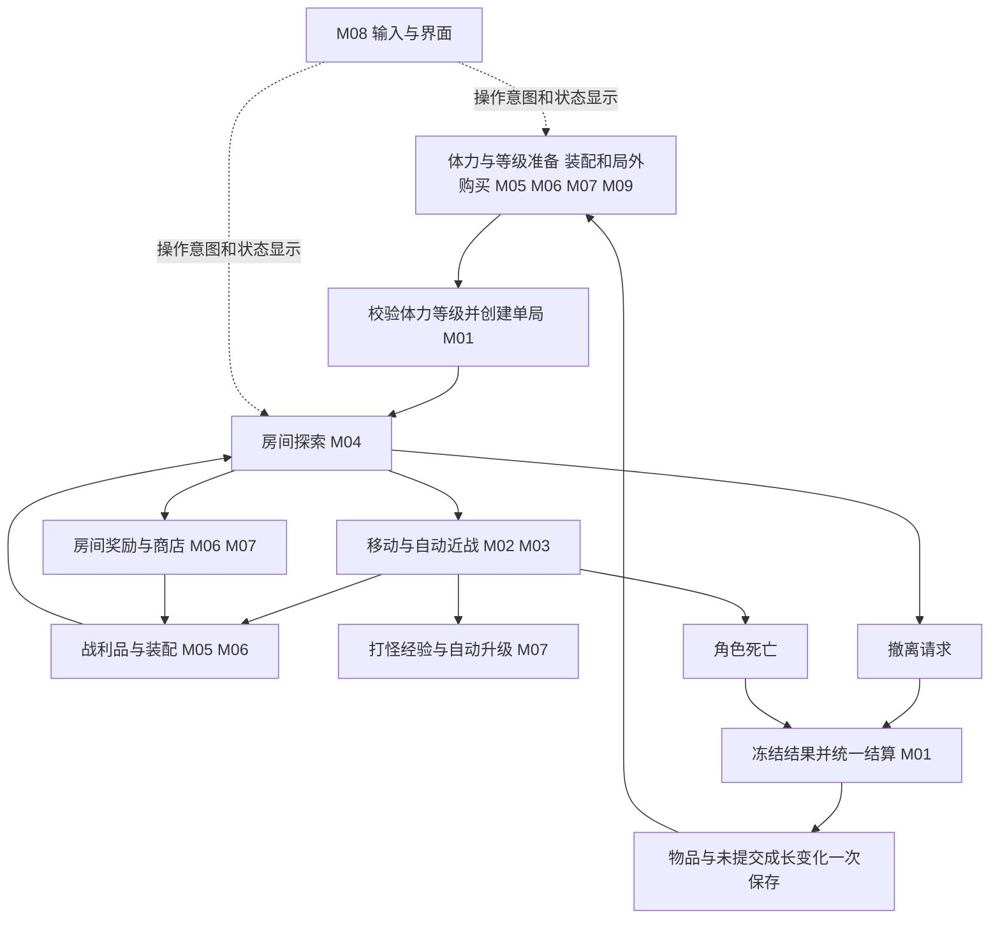

# 玩法模块与迭代计划

更新日期：2026-09-29。状态：模块设计草案，供后续按模块细化和迭代；尚未实现。

玩法规则以[核心玩法设计](核心玩法设计.md)为准。本文件负责模块划分、协作契约和开发顺序；标注“建议”的内容是本次设计方案，不能反向覆盖已确认规则。工程基础能力及验证状态见[项目基础接入验收](项目基础接入验收.md)。

## 1. 设计目标

将“局外体力与装配准备 → 探索与自动近战 → 打怪获得经验、装备和技能 → 继续冒险或撤离 → 结算与自动升级 → 局外购买和解锁”拆成 9 个项目玩法模块。每个模块有独立的数据责任和验收场景，每轮迭代形成可操作的完整片段。

这些是 `GameLogic` 内的业务划分，不代表新增 9 个框架模块、程序集或独立服务。建议先采用清晰目录和小接口，按实际复杂度拆分实现。

## 2. 模块目录与责任

| ID / 设计文档 | 负责的核心问题 | 可交付结果 | 不承担的职责 |
| --- | --- | --- | --- |
| [M01 单局流程与结算](模块设计/M01-单局流程与结算.md) | 一局何时开始、结束，以及收益如何最终保存 | 入场、撤离、死亡、结算和返回局外的闭环 | 不计算武器命中或生成掉落 |
| [M02 角色移动与自动近战](模块设计/M02-角色移动与自动近战.md) | 玩家如何移动、索敌和完成统一近战攻击 | 可操控角色与自动近战手感 | 不按武器新增攻击操作，不保管物品 |
| [M03 敌人与房间战斗](模块设计/M03-敌人与房间战斗.md) | 敌人如何构成威胁，如何判断战斗结束 | 小怪、Boss、受击死亡与清房事件 | 不直接发放物品或结束整局 |
| [M04 程序化关卡与房间探索](模块设计/M04-程序化关卡与房间探索.md) | 房间如何连接、探索和出现撤离点 | 房间图、进出房、探索记录和地图投影 | 不决定物品保留与经验奖励 |
| [M05 物品装备与技能](模块设计/M05-物品装备与技能.md) | 每个物品是什么、数值和效果是什么 | 装备随机属性、技能物品与效果计算 | 不拥有背包位置或保存整局结果 |
| [M06 战利品背包与安全箱](模块设计/M06-战利品背包与安全箱.md) | 物品从哪里来、由谁持有、放在哪里 | 掉落、拾取、装配位置、背包、安全箱和局外存储 | 不重复随机属性，不单独提交结算 |
| [M07 局外成长与商店](模块设计/M07-局外成长与商店.md) | 打怪/撤离经验如何升级，等级如何约束使用和购买 | 自动升级、装备/技能/关卡/局外购买门槛，NPC 与局外交易 | 不直接修改背包或单独保存单局结算 |
| [M08 UI交互与跨平台体验](模块设计/M08-UI交互与跨平台体验.md) | 玩家如何理解状态并发出操作 | 局外界面、HUD、小地图、物品交互与平台适配 | 不自行生成奖励、判定命中或更改存档 |
| [M09 体力与每日补给](模块设计/M09-体力与每日补给.md) | 如何按体力控制出战节奏并处理时间补给 | 上限 100、每局 10、每 6 分钟恢复 1、5 点重置到 100、12/18/24 点各手动领取 40 的配置和状态 | 不管理战斗生命值、角色等级或物品 |

M07 将成长与商店分节设计，覆盖 NPC 房与新增局外商店；具体商品和货币是否共用待定。M09 独立维护体力与日期状态，原 M01～M08 编号保持稳定。M08 从首个可玩片段起提供必要界面，不等其他模块全部完成后才接入。

## 3. 可玩性如何落到模块

| 玩家做出的选择 | 对应模块 | 需要验证的体验 |
| --- | --- | --- |
| 调整站位，利用攻击范围，绕开敌人危险区域 | M02、M03、M05 | 自动攻击下，移动和接近时机仍能改变战斗结果 |
| 选择下一个房间，寻找收益或撤离机会 | M04、M03、M08 | 房间信息能帮助规划，未知部分能带来探索价值 |
| 比较随机装备、技能与当前搭配 | M05、M06 | 不同属性和效果能改变策略，避免只比较单一战力数字 |
| 将有限安全箱空间留给更想保住的物品 | M06、M08 | 容量限制形成取舍，转移和保护状态清晰 |
| 带着已有收益继续探索，或找到撤离点后离开 | M01、M04、M06 | 继续冒险有可理解的收益和损失风险 |
| 把带回的物品用于下一局，并挑战解锁的关卡 | M05、M06、M07 | 局外积累与局内变化共同推动下一局 |
| 根据体力、补给与等级安排出战和局外准备 | M09、M07、M08 | 体力限制与等级门槛的组合是否符合预期节奏，用实际对局长度验证 |

以上是要用原型验证的体验目标，不是已经验证的可玩性结论。若自动战斗只剩站桩比数值，应优先调整敌人威胁、范围与走位反馈；增加物品数量不能替代这一验证。

## 4. 协作与状态所有权

以下名称都是拟议的数据契约，不是当前已有 API。跨模块传递标识与数据快照，避免传递可任意修改的内部集合。

| 契约 / 标识 | 权威来源 | 使用方与约束 |
| --- | --- | --- |
| `RunId`、`RunContext` | M01 | 一局一个标识；运行时事件携带它，上一局迟到事件无效 |
| `RoomId`、`RoomGraph`、探索状态 | M04 | 房间访问和内容恢复使用稳定 ID；视觉卸载不代表重置房间 |
| `ActorId`、战斗快照、死亡事件 | M02 管玩家位置/行动，M03 管敌我生命/伤害 | M03 汇总死亡与房间战斗完成；一次死亡只形成一个有效事件 |
| `ItemDefinitionId`、`ItemInstanceId`、实例随机值 | M05 | M06 持有实例与位置；换房、装配、存取和结算不重新随机 |
| `SourceId`、战利品生成记录、容器位置 | M06 | 同一局同一奖励来源最多领取一次；已生成实例不重抽 |
| `PurchaseId`、`ShopContextId` | M07 协调，M06 校验库存 | NPC 与局外交易统一按购买标识去重，局外购买不依赖 RunId |
| `CombatProfile` | M05 按 M06 装配状态计算 | M02 读取数值和效果；安全箱内效果是否生效由待定规则决定 |
| `MinimapProjection` | M04 | M08 只读取房间展示信息，不包含撤离点标记或可推断其存在的特殊字段 |
| 撤离点可用状态 / 撤离请求 | M04 / 玩家交互 | M01 校验当前局、角色和有效撤离点，统一决定结束 |
| `InventorySnapshot`、物品结算计划 | M06 | M01 冻结并用于整局结算，不能逐件发放后才补存档 |
| 经验来源记录、自动升级与四类等级资格 | M07 | M03 提供打怪事实；M01 结算只应用未提交增量及撤离奖励。打怪经验死亡保留和局内生效时机待定 |
| 体力状态、扣费计划、日期与补给领取记录 | M09 | M01 校验出战并按最终时点扣费；M08 查询/领取，不能自行计时加体力 |
| `RunOutcome`、结算提交结果 | M01 | 一个结束结果；保存确认后 M08 才展示成功及开放下一局 |

建议由项目组合入口连接这些接口。关键请求有明确返回结果；展示刷新可以订阅事件，但不通过多方订阅同一事件分别发奖励来完成结算。

持久化沿用同一项目存档入口：M01 协调入场与终局事务，M07 协调局外交易，M09 提交补给/时间状态变化；各方基于最新状态串行提交，不能用旧的整局快照覆盖后来领取的体力或已记经验。局外操作不依赖创建单局。

## 5. 必须守住的共同行为

1. **结算唯一。** 撤离和死亡最终只能接受一个结果；重复事件和保存重试不能重复发物品、经验或解锁。并发触发的结果优先级另行定规则。
2. **物品唯一。** 同一实例同一时刻只有一个所属位置；携入关卡是转移所有权，不能在局外保留一份可再次取用的副本。
3. **规则不缩水。** 成功撤离接收全部当前持有物品；死亡只保留安全箱内物品，包含技能物品；安全箱容量 X 仍待配置。
4. **随机结果稳定。** 物品实例生成后保存实际数值；同一房间反复进入不能重刷已领取奖励、复活已击败 Boss 或复制商店商品。
5. **展示服从事实。** 小地图不显示撤离点；存档尚未确认不能显示结算已完成；界面关闭不能自动等同于撤离或死亡。
6. **退出收尾明确。** 停止输入和战斗、冻结结算数据，再释放本局资源；数据不能随着房间对象销毁而丢失。
7. **局外状态各有来源。** 同局体力不重复扣除、同日同补给时段不重复领取，打怪经验与撤离经验分别去重；等级资格由业务模块校验，不能只禁用 UI 按钮。
8. **经验与物品分开处理。** 安全箱只定义物品保护；不能用箱内外规则推导打怪经验的死亡保留政策。

全失后如何再次出战、异常退出如何处理、技能如何装备和安全箱如何存取都是玩法空缺，按下表进入对应迭代前补齐；不以隐藏默认值替代决定。

## 6. 建议迭代顺序

每轮只扩展一段可体验的闭环，前一轮保留为回归场景。文中的测试数据是开发夹具，不代表正式房间数量、装备数值或安全箱默认容量。

| 迭代 | 参与模块 | 本轮可玩交付 | 完成判据 / 下一步入口 |
| --- | --- | --- | --- |
| I0 规则与契约落定 | M01、M02、M05、M06，M08 配合 | 固定关键标识、配置结构和状态责任，准备单房间测试内容 | 确定 I1 必要战斗规则；结算真值表和待定项有明确归属，不建设一整套空实现 |
| I1 单房间战斗 | M02、M03、M04 固定测试房夹具、M05 最小属性输入、M08 基础 HUD | 在测试房移动，自动近战攻击，敌人受击和死亡，支持重开 | 能靠走位影响生存和输出；没有目标不攻击；敌人不会重复死亡；触屏与 PC 均能控制 |
| I2 一局收益与损失 | M01、M06、M05 最小物品、M04 固定撤离测试点、M07 打怪/撤离经验最小实现、M09 体力准入、M08 | 按体力和等级准入进入测试房、打怪获得经验、拾取和转移到安全箱、撤离或死亡，再次入场 | 全带出 / 箱外全失 / 技能保护 / 体力只扣一次 / 经验不重发 / 保存失败重试通过；测试点不代表正式刷点方案 |
| I3 程序化探索 | M04、M03、M06、M08 | 房间图生成、切房、四类房间节点及占位、小地图、按配置出现撤离点 | 生成内容可达；清房与奖励记录可恢复；小地图不泄露撤离点；未接入内容的 Boss/NPC 节点只做开发占位 |
| I4 装备与局外成长循环 | M05、M06、M07、M09、M01、M03、M08 | 武器随机值、技能效果、Boss 奖励、NPC/局外购买、四类等级门槛、自然恢复/跨日重置/定时体力领取 | 装备变化能被战斗感知；装配与保护一致；购买/领取无重复；时间结算和升级保存一致 |
| I5 节奏与平台验证 | 全模块，M08 牵头 | 完整多局流程、横竖屏、触控、资源与存档平台验证 | 用实际游玩评估走位价值、撤离选择、体力限制与等级门槛的叠加、损失后重开意愿；在目标设备验证，不用 Editor 结果代替 |

I3 的节点占位不计为四类房间内容已完成；可战斗 Boss 一经接入就必须带有必掉奖励，不能等到后续迭代再补。I1 验证操作基础，I2 验证“搜打撤”闭环，I4 才能完整判断长期积累与随机构筑的组合效果。I1～I4 每轮都做基础竖屏适配；平台接入前置工作可以提前，不将全部移动端风险推迟到 I5。

## 7. 待定规则与最晚处理节点

| 决策 | 归属 | 必须处理的节点 |
| --- | --- | --- |
| 索敌优先级、攻击方向/形状、移动攻击关系、攻击节奏和遮挡 | M02、M03 | I1 行为实现前 |
| 玩家受伤方式、敌人攻击预警、失去装备后如何重新入场 | M02、M03、M06 | I1 定受伤规则；I2 前确定重新入场方式 |
| 同时撤离与死亡的处理、暂停/关闭/异常中断策略 | M01、M08 | I2 真实结算前；不能默认异常中断算撤离或死亡 |
| 背包/安全箱容量单位、堆叠、存取时机、放入限制及保护与装备关系 | M06、M05 | I2 容器交互前；X 的正式值可继续配置化 |
| 打怪计奖口径、两类经验数值、自动升级生效时机、打怪经验死亡保留 | M07、M03、M01 | I2 接入真实成长前；死亡本身不新增经验来源 |
| 体力扣费时点、失败返还；时区、领取窗口/溢出、离线恢复及重置边界顺序 | M09、M01 | I2 确定扣费与准入，I4 前确定时间与补给细节 |
| 房间数量和连接规则、门锁、刷点条件/概率、是否保证存在撤离点、地图揭示范围 | M04、M03、M08 | I3 生成规则前 |
| 技能装备与触发、武器附带技能关系、随机值区间、NPC/局外商店货币、商品共享与交易规则 | M05、M06、M07 | I4 对应功能前 |
| 装备/技能/关卡/局外购买等级门槛、长期装备成长边界、正式容量和数值调优 | M07、M05、M06 | I4 参数方案；I5 游玩调整 |
| 是否保留三选一奖励、是否增加独立临时强化 | M05、M06 | 后续扩展前；不属于当前首版必做 |

## 8. 工程落地与文档维护

- 建议项目代码目录使用 `GameLogic/Runtime/Gameplay` 下的 `Runs`、`Player`、`Enemies`、`World`、`Items`、`Inventory`、`Progression`、`Stamina`，UI 和存档可沿用项目层的 `UI`、`Save` 目录；这只是后续目录建议，本轮不创建空代码。
- 配置接入既有 Excel 导表链路，资源放在 `GameResources`，状态与生命周期通过现有输入、资源、UI、作用域和存档能力接入；不让框架反向依赖本项目物品或房间规则。
- [关卡与单局流程](../framework/关卡与单局流程.md)提供通用 Flow 参考，[正式存档使用指南](../framework/正式存档使用指南.md)提供存储边界；其中 Demo 是框架样例，不代表本项目已有相关玩法或存档字段。
- 每个模块开发时先更新本模块待定规则与验收范围，再实现最小片段；涉及共享契约时同步修改本文件和调用方文档。已确认玩法变更回写[核心玩法设计](核心玩法设计.md)。
- 模块文档中的验收项是未来开发的通过条件。本轮仅验收文档完整性和链接，不将任何待实现条目标为已经通过。

返回[项目文档导航](README.md)。
